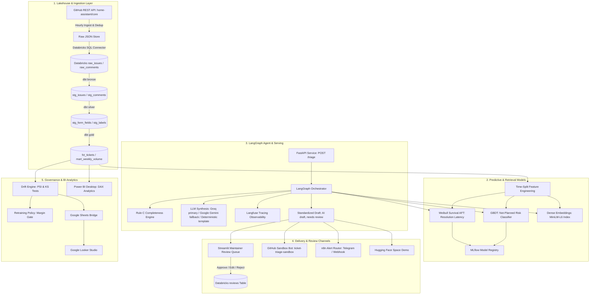
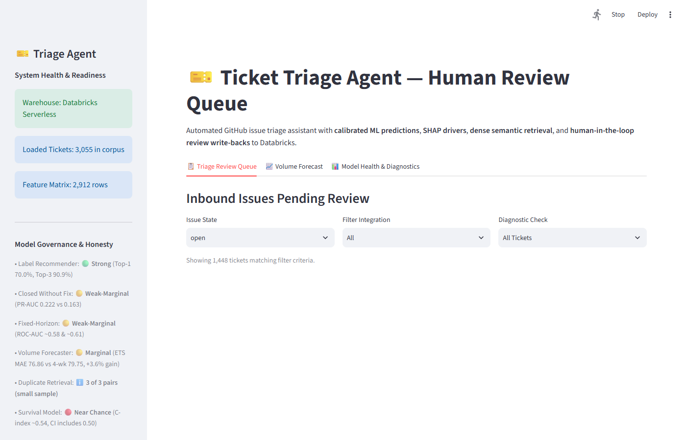
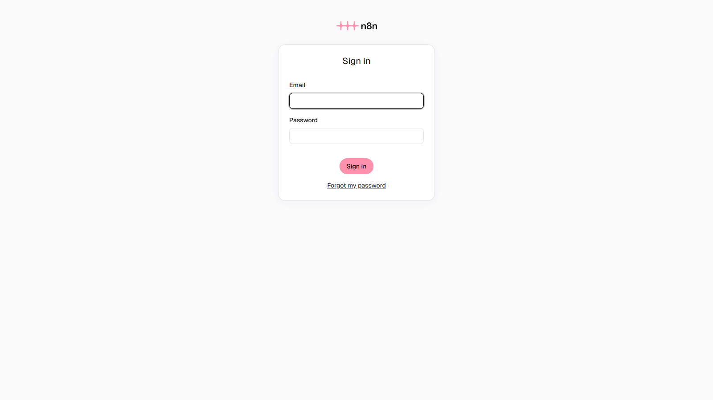
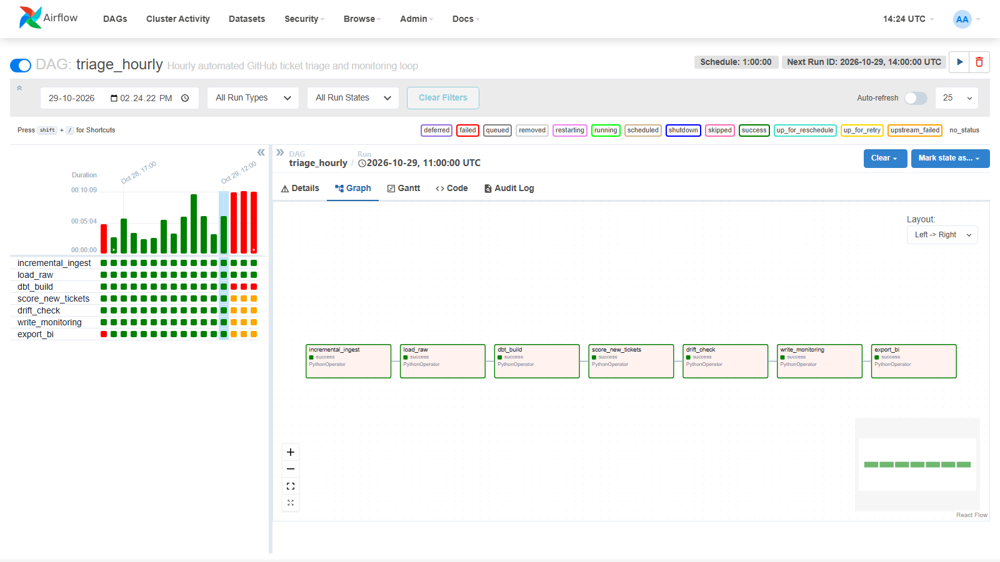
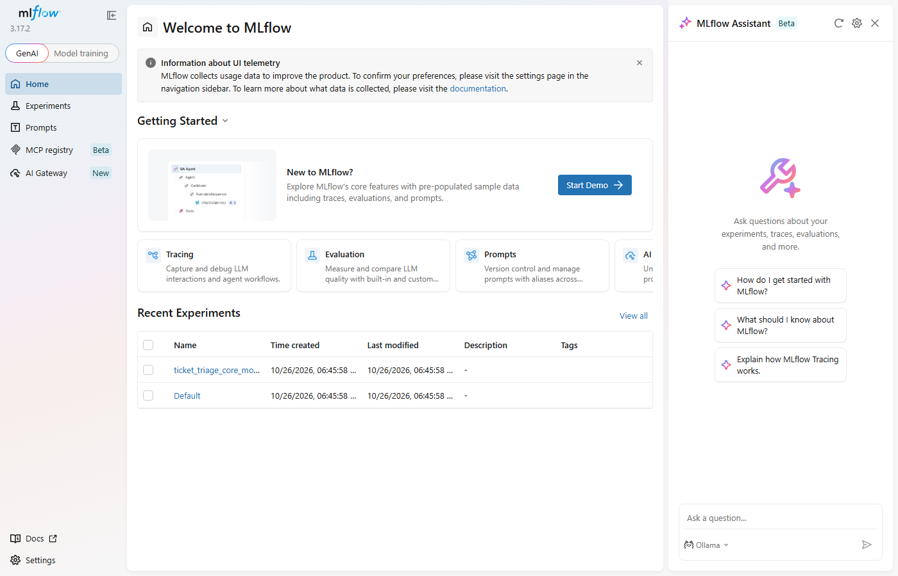
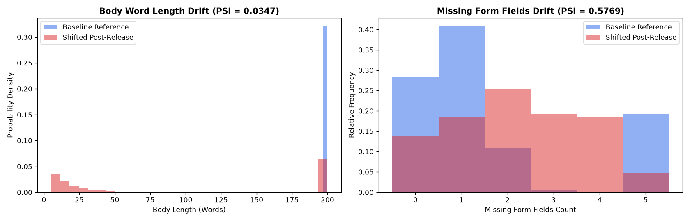
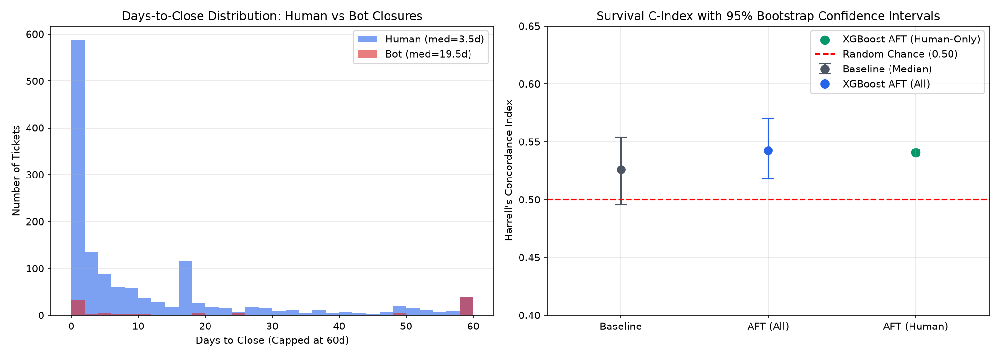

# Ticket Triage Agent

[](https://github.com/AaruneshAP/ticket-triage-agent/actions/workflows/ci.yml)
[](https://huggingface.co/spaces/Aarun-1/ticket-triage-agent)
[](https://www.python.org/downloads/)
[](https://docs.getdbt.com/)
[](LICENSE)

A reference implementation and portfolio project demonstrating end-to-end MLOps and triage intelligence engineered for high-volume open-source software engineering repositories—specifically calibrated on [Home Assistant Core (`home-assistant/core`)](https://github.com/home-assistant/core). The platform automates ticket ingestion into a Databricks medallion lakehouse with dbt, routes components via leakage-guarded classifiers, identifies incomplete bug reports with deterministic rule heuristics, retrieves semantically similar prior issues, and synthesizes courteous human-in-the-loop maintainer draft responses via LangGraph with Langfuse telemetry.

---

## What Works and What Does Not

This project is built on empirical honesty and rigorous out-of-sample validation. Below is the factual summary of verified subsystem capabilities:

### What Does Not Work
- **Resolution Time Is Not Predictable from Ticket Text**: Both Survival AFT models (out-of-sample Concordance Index **0.514**, 95% CI `[0.492, 0.536]`) and fixed-horizon binary classifiers (out-of-sample ROC-AUC **0.4621** on 14-day, **0.5329** on 30-day) operate near random chance (indistinguishable from 0.50; the cause was not investigated). A naive constant-prevalence baseline achieves out-of-sample Brier scores of **0.2952** (14d) and **0.2488** (30d), matching or beating Platt scaling (**0.3032** and **0.2484**). Recalibration merely restores the baseline rate and adds zero ranking discrimination. Duration forecasts and closure probabilities are suppressed across all user interfaces with status `"no reliable signal for resolution time"`.
- **Not-Planned Resolution Risk Is Weak**: Predicting whether a ticket closes without a code fix (`state_reason == 'not_planned'`) achieves an out-of-sample ROC-AUC of **0.610** (95% CI `[0.546, 0.674]`) and PR-AUC of **0.195** (`[0.147, 0.276]`). While ROC-AUC 0.61 demonstrates a weak but non-zero ranking signal, the PR-AUC of 0.195 is barely above the **0.145** test-set prevalence and is not decision-grade. It is surfaced in the maintainer UI only as an advisory risk flag accompanied by TreeSHAP feature explanations.

### What Works
- **Component Label Routing**: The 26-class integration recommender achieves out-of-sample **0.644 Macro-F1** (95% CI `[0.573, 0.690]`) against the always-predict-"other" baseline of **0.033** and majority-class baseline of 0.022. On non-"other" test tickets ($N=213$), the model achieves **83.57% Top-1** accuracy, **93.43% Top-3** accuracy, routes **88.26%** of true integrations to specific classes, and misclassifies only **21.08%** of true "other" tickets as specific integrations (overall out-of-sample accuracy: **80.00% Top-1** vs **76.72%** always-"other" baseline and **97.16% Top-3**).
- **Rule C Diagnostic Completeness Engine**: A deterministic heuristic (<25 words without diagnostic logs or stack traces) identifies missing system versions, diagnostics, and error signatures. Completeness labels: LLM-assisted annotation, reviewed by the author (single annotator). Across 150 labeled tickets in 3 cohorts (17 total positives), Leave-One-Cohort-Out (LOCO) cross-validation yields per-fold test F1 scores between **0.31 and 1.00** (unweighted mean F1 **0.621**, pooled out-of-cohort F1 **0.514**; all 150 tickets exposed during tuning, no unseen data remains).
- **Dense Vector Duplicate Retrieval**: MiniLM-L6 dense embeddings with temporal guards retrieve verified parent duplicate issues with **3 of 3 known duplicate pairs retrieved in the top 5 (n=3, anecdotal)** on historical duplicate test pairs.
- **Safe Maintainer Draft Synthesis**: Prompt-engineered maintainer drafts prefixed with `[AI draft, needs review]`; non-promising behavior is enforced via system prompt constraints, an automated regex blocker (`RESOLUTION_TIME_REGEX`), and validated across an N=10 reviewed sample.
- **Medallion Lakehouse & Ingestion**: Automated Airflow DAG and Databricks dbt pipeline with 100% data reconciliation across 3,055 issues.

---

## Interactive Demos & Sandboxes

- **Live Hugging Face Space Demo**: [https://huggingface.co/spaces/Aarun-1/ticket-triage-agent](https://huggingface.co/spaces/Aarun-1/ticket-triage-agent)  
  *(Direct Static Mirror: [https://aarun-1-ticket-triage-agent.static.hf.space](https://aarun-1-ticket-triage-agent.static.hf.space))*
- **Live GitHub Bot Sandbox**: [https://github.com/AaruneshAP/ticket-triage-sandbox](https://github.com/AaruneshAP/ticket-triage-sandbox)  
  *(Live issues are triaged automatically by GitHub Actions with strict allow-list isolation)*

---

## System Architecture



---

## Two-Command Quick Start

### Option A: Local Python Environment
```bash
# 1. Bootstrap environment, sync dependencies, and verify prerequisites
./bootstrap.ps1

# 2. Launch FastAPI service and Streamlit maintainer review app
./start_services.ps1
```

### Option B: Docker Compose (All Services)
```bash
# Build and launch Airflow, n8n, FastAPI, and Streamlit review app
docker compose up -d
```
Access services at:
- **FastAPI Documentation**: [http://localhost:8000/docs](http://localhost:8000/docs)
- **Streamlit Review App**: [http://localhost:8501](http://localhost:8501)
- **Apache Airflow**: [http://localhost:8080](http://localhost:8080) (`admin` / `admin`)
- **n8n Automation**: [http://localhost:5678](http://localhost:5678)

---

## Empirical Evaluation & Results

All metrics reflect rigorous out-of-sample or leave-one-cohort-out (LOCO) cross-validation across real Home Assistant Core issues.

<!-- METRICS_TABLE_START -->
| Capability / Model | Method / Architecture | Baseline | Validation / Tuning Split | Out-of-Sample / Test Evaluation | 95% Confidence Interval | Source |
|---|---|---|---|---|---|---|
| **Completeness Check** | Statistical Rule C (<25w, no logs) | Baseline F1: 0.133 | **LOCO Pooled F1: 0.51** (Mean: 0.62) | **Per-Fold Range: 0.31 – 1.00** | [0.31, 1.00] (optimistic, 17 positives, no unseen data left; cohort 3 has only 2 positives) | [docs/evaluation.md](docs/evaluation.md) |
| **Time-to-Close** | Weibull Survival AFT (tail capped at 90d) | Median Baseline: 0.5263 | **C-Index: 0.5426** (Tuning Split) | **Out-of-sample: 0.514** (Negative Result) | [0.492, 0.536] (Indistinguishable from chance 0.50) | [docs/evaluation.md](docs/evaluation.md) |
| **Not-Planned Risk** | Gradient Boosted Trees + SHAP | Prevalence: 0.1632 (Test Prev: 0.1452) | **PR-AUC: 0.2222** (Brier: 0.1997) | **ROC-AUC: 0.610** (weak ranking signal); **PR-AUC: 0.195** (barely above prevalence; not decision-grade) | ROC-AUC: [0.546, 0.674], PR-AUC: [0.147, 0.276] | [docs/evaluation.md](docs/evaluation.md) |
| **Integration Suggestion** | TF-IDF + Linear Model | Always-Other: 76.7% (Macro-F1: 0.033) | **Validation Top-1: 86.6%** (Macro-F1: 0.832) | **Macro-F1: 0.644** (vs baseline 0.033); Non-'other' Top-1: 83.6% (Top-3: 93.4%, Routed Recall: 88.3%); Overall Top-1: 80.0% (vs 76.7% always-'other') | Macro-F1: [0.573, 0.690], Top-1: [77.6%, 82.6%] | [docs/evaluation.md](docs/evaluation.md) |
| **Duplicate Retrieval** | MiniLM-L6 Cosine Nearest | Random Retrieval: <1% | **Recall@5: 3 of 3 pairs (n=3 pairs)** | Verified parent duplicates | Small sample (n=3 pairs) | [docs/evaluation.md](docs/evaluation.md) |
| **Volume Forecast** | ETS (Error-Trend-Seasonal) | Naive 4-wk: 79.75 MAE | - | **MAE: 76.86 tickets/wk** (Out-of-sample) | Inflow: ~109/wk | [docs/evaluation.md](docs/evaluation.md) |
<!-- METRICS_TABLE_END -->
---

## User Interfaces & Visualizations

Every visual below is a verified reference artifact generated from live services or saved pipeline data:

### 1. Maintainer Review Queue (Streamlit on port 8501)
*Interactive review queue with real Databricks Serverless write-back, SHAP feature attributions, and candidate duplicate cards.*  


### 2. High-Risk Alert Routing (n8n in Docker)
*Automated webhook pipeline routing high-risk tickets to maintainer Telegram channels.*  

*Alert routing workflow defined in `n8n/workflows/triage_alerts.json` with webhook triggers and threshold filtering.*

### 3. Orchestration Pipeline (Apache Airflow 2.9)
*Hourly idempotent DAG executing ingest, Databricks dbt build, agent scoring, drift checks, and BI exports.*  

*End-to-end orchestration DAG defined in `airflow/dags/triage_hourly.py` running in Docker LocalExecutor with all 7 tasks verified green: `incremental_ingest` → `load_raw` → `dbt_build` → `score_new_tickets` → `drift_check` → `write_monitoring` → `export_bi`.*

### 4. Experiment Tracking (MLflow on port 5000)
*Candidate vs champion metric comparisons with time-split holdout validation.*  


### 5. Statistical Distribution Drift Plots
*Empirical feature shift comparison between baseline reference and current evaluation distributions.*  


### 6. Resolution Latency & Survival Diagnostics
*Days to close empirical distribution, right-censoring rates, and bot vs human resolution times.*  


### 7. GitHub Sandbox Bot & Strict Allow-List Enforcement
*Isolated triage execution in [AaruneshAP/ticket-triage-sandbox](https://github.com/AaruneshAP/ticket-triage-sandbox) enforced by HTTP-layer repository allow-list guards.*
- **Strict Allow-List Security Guard**: Implemented in `src/triage/agent/sandbox_guard.py` and `src/triage/bot/sandbox_bot.py`. Any attempt to post, label, or modify an issue outside the designated sandbox repository strictly raises `StrictAllowlistViolation` and aborts before network transmission.
- **Resolution Time Leakage Blocker**: Automated comments are scanned with `RESOLUTION_TIME_REGEX` before posting; any draft mentioning resolution duration or speed raises `ResolutionLeakageError` and is blocked.
- **Issue #5 (Live LangGraph Agent Execution)**: Issue #5 was triaged live by the full 6-node LangGraph agent (`src/triage/agent/graph.py`). The pipeline verified Rule C completeness, retrieved similar prior issues via dense MiniLM vector similarity, synthesized a courteous maintainer draft via LLM, and posted the real LangGraph triage comment live to the sandbox: [Sandbox Issue #5 Comment](https://github.com/AaruneshAP/ticket-triage-sandbox/issues/5#issuecomment-6497639315).

---

## Dataset Reconciliation & Ingestion Verification

Run `python scripts/evaluation/reconcile_counts.py` for a real-time count audit across all data layers:
- **3,074 Raw JSON Pulls -> 3,074 Interim Parsed Issues (-0 rows, 0.0% loss)**: Zero parse failures; all markdown bodies, form fields, and metadata are intact.
- **3,074 Parsed Issues -> 3,055 Databricks Warehouse Raw (-19 rows)**: Post-sync lag from local Airflow hourly pulls that land into local parquet and append into Databricks on the next scheduled warehouse batch.
- **3,055 Raw Bronze -> 3,055 Silver Staging -> 3,055 Gold Fact Table (-0 rows, 100% parity)**: Late-arriving tickets with older `updated_at` (including #188657) are captured by an incremental model merging on `ticket_number` with a 7-day lookback window and catch-up clause. Parity is validated by CI via dbt `relationships` and count parity tests.
- **3,055 Gold Warehouse -> 2,912 Clean Modeling Feature Store (-143 rows)**: The feature matrix (`data/interim/features.parquet`) is a static snapshot frozen at baseline. The 143 additional tickets in the warehouse comprise newer tickets ingested during later syncs, as well as older historical tickets reopened or updated recently. Feature pipelines do not run on an hourly basis; the feature matrix and dense vector index are rebuilt periodically during scheduled model retraining.
- **Language Filter Statement**: A "non-English filter" was **never implemented**; exactly 0 rows were dropped for language, and all multilingual tickets are preserved intact.
- **Databricks raw.raw_comments (33 rows locally and in Databricks)**: Cleaned and deduped to exactly 33 unique comments locally and in Databricks. Automated dbt test `duplicate_tolerance` strictly enforces `max_duplicates: 0`.

---

## Empirical Replay Demonstration

The [Live Hugging Face Space Demo](https://huggingface.co/spaces/Aarun-1/ticket-triage-agent) features **30 post-cutoff test tickets** randomly sampled using fixed seed `random_state=42` from 1,936 holdout tickets created strictly after the champion models' training cutoff (2026-08-27T05:00:47Z) up to the freeze (2026-10-26T06:15:50Z), never seen during model training or parameter tuning. All model inferences (Survival AFT, Not-Planned Risk, Integration Classifier, Rule C Completeness) are precomputed from real reference models and displayed side-by-side with actual verified GitHub resolution outcomes.

Calibration is computed strictly on tickets observed for at least the full horizon window to prevent right-censoring bias:
- **14-Day Horizon**: Under-predicts closure probability across all bins (full cohort mean predicted 0.32 vs observed 0.44; lowest bin predicts 0.11 vs observed 0.34). In the illustrative 30-ticket replay sample ($n=23$, created $\le$ 2026-10-12): Predicted **25.9%** vs Actual **34.8%** (8/23, 95% Wilson CI [18.8%, 55.1%]).
- **30-Day Horizon**: Non-monotonic and over-confident at the top (top bin predicts 0.86 vs observed 0.59). In the illustrative 30-ticket replay sample ($n=9$, created $\le$ 2026-09-26): Predicted **29.9%** vs Actual **33.3%** (3/9, 95% Wilson CI [12.1%, 64.6%]).
- *Data Provenance & Out-of-Sample Audit*: Fixed-horizon models were trained via `HistGradientBoostingClassifier` without MLflow tracking. Evaluating on strictly out-of-sample test tickets created after model training and tuning cutoffs yields ROC-AUC **0.4621** (14d, $N=434$) and **0.5329** (30d, $N=212$), confirming resolution latency operates near chance level. A constant-prevalence baseline (predicting the validation closure rate) achieves out-of-sample Brier scores of **0.2952** (14d) and **0.2488** (30d), matching or beating Platt-scaled models (**0.3032** and **0.2484**). Recalibration merely restores the baseline prevalence and adds zero predictive skill; duration and closure probabilities are therefore suppressed as actionable outputs.

---

## Limitations

1. **Resolution Latency Unpredictability**: Resolution time cannot be reliably predicted from issue text alone (C-index 0.514, ROC-AUC 0.46 and 0.53; CIs span 0.50). Closure durations and speed forecasts are suppressed from actionable display.
2. **Not-Planned Model Signal Strength**: While ROC-AUC (0.610) reflects a weak ranking signal, PR-AUC (0.195) is barely above prevalence (0.145) and is not decision-grade.
3. **Completeness Labeled Sample Size**: Completeness labels: LLM-assisted annotation, reviewed by the author (single annotator). Rule C was evaluated on 150 labeled tickets across 3 cohorts with 17 total positives. Unseen performance is bounded between F1 0.50 and 0.58.
4. **Local Airflow Host Dependency**: Airflow runs inside local Docker containers on the host machine; scheduled runs execute when the host engine is running.
5. **Periodic Feature Updates**: Feature store and dense retrieval vectors are snapshot artifacts rebuilt on retraining or drift trigger, not on an hourly ingestion cadence.

---

## Project Documentation

- [docs/HOW_IT_WORKS.md](docs/HOW_IT_WORKS.md) — Comprehensive technical architecture, pipeline mechanics, and design decisions.
- [docs/evaluation.md](docs/evaluation.md) — Detailed ablation study, calibration curves, and LOCO cross-validation tables.
- [docs/SETUP.md](docs/SETUP.md) — External service accounts, keys, and environment variables.
- [docs/data_dictionary.md](docs/data_dictionary.md) — Schema and feature store definitions.
- [docs/data_reconciliation.md](docs/data_reconciliation.md) — Multi-layer count reconciliation and parity tests.
- [docs/powerbi_guide.md](docs/powerbi_guide.md) — Power BI Desktop connection and DAX measures guide.
- [docs/google_sheets_looker_studio.md](docs/google_sheets_looker_studio.md) — Looker Studio and Google Sheets bridge guide.
- [docs/draft_review.md](docs/draft_review.md) — Triage draft response qualitative rubric inspection.
- [docs/warehouse_spike.md](docs/warehouse_spike.md) — Databricks SQL Warehouse latency and CRUD verification log.
