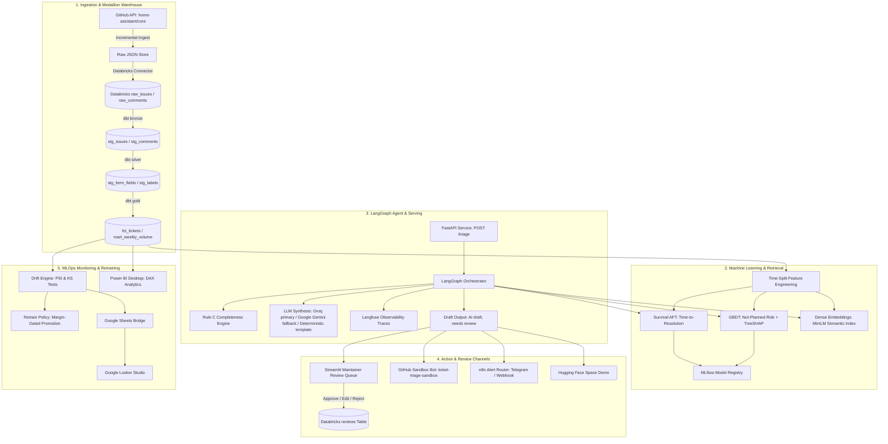

# How It Works: Technical Architecture & Deep Dive

The **Ticket Triage Agent** is a reference implementation and portfolio project demonstrating end-to-end MLOps and agentic triage engineered for high-volume open-source software repositories—specifically calibrated on [Home Assistant Core (`home-assistant/core`)](https://github.com/home-assistant/core).

This document serves as a complete technical reference detailing the design philosophy, architectural components, statistical machine learning pipelines, agent orchestration, data governance, and empirical discoveries of the platform.

> [!IMPORTANT]
> **Foundational Empirical Finding: Resolution Latency Is Not Predictable from Ticket Text**
>
> A central conclusion of our reference evaluation is that **ticket resolution time cannot be predicted from bug report text** in this repository:
> - **Empirical Proof**: On strictly out-of-sample holdout cohorts, the Survival AFT Concordance Index is **0.514** (95% CI: `[0.492, 0.536]`, indistinguishable from chance 0.50), and fixed-horizon binary classifiers drop to ROC-AUC **0.4621** (14-day, $N=434$) and **0.5329** (30-day, $N=212$), both crossing 0.50.
> - **Zero Recalibration Skill**: A naive constant-prevalence baseline (predicting the validation closure rate) achieves out-of-sample Brier scores of **0.2952** (14d) and **0.2488** (30d), matching or beating Platt-scaled models (**0.3032** and **0.2484**). Recalibration merely restores the baseline prevalence and adds zero predictive skill.
> - **Resolution Latency**: Models show no out-of-sample predictive signal; the cause was not investigated. Duration and closure probability fields are suppressed from actionable display across all endpoints (`"no reliable signal for resolution time"`).
>
> **Where the Real Value Lies (The Verified Working System)**:
> Rather than relying on ungrounded duration guesses, the practical value of this platform centers on the high-signal, operationally verified components:
> 1. **High-Accuracy Component Routing**: Out-of-sample **0.644 Macro-F1** (95% CI: `[0.573, 0.690]`) vs always-"other" baseline 0.033; non-"other" test tickets achieve **83.6% Top-1** accuracy and **88.3%** routed recall (overall Top-1 80.0% vs 76.7% always-"other" baseline; validation: 86.6% Top-1, 0.832 Macro-F1).
> 2. **Rule C Diagnostic Completeness Engine**: Deterministic rules identifying missing versions, diagnostics, and stack traces (Completeness labels: LLM-assisted annotation, reviewed by the author (single annotator); LOCO pooled F1 **0.51**, 17 positives across 3 cohorts; fold mean **0.62**, with only 2 positives in cohort 3; per-fold range **0.31 – 1.00**; optimistic, 17 positives, no unseen data left).
> 3. **Dense Vector Duplicate Retrieval**: MiniLM-L6 semantic search with temporal guards to detect duplicate issues (**3 of 3 known duplicate pairs retrieved in the top 5 (n=3, anecdotal)**).
> 4. **Safe Maintainer Draft Responses**: Prompt-engineered maintainer drafts prefixed with `[AI draft, needs review]`; non-promising behavior is enforced via system prompt constraints, an automated regex blocker (`RESOLUTION_TIME_REGEX`), and validated across an N=10 reviewed sample.
> 5. **Medallion Data Lakehouse & Ingestion**: Automated hourly Airflow DAG and Databricks dbt pipeline (Bronze -> Silver -> Gold) with 100% data reconciliation and parity tests.
> 6. **Continuous MLOps & Drift Governance**: Hourly PSI and KS test tracking, automated model promotion gates, and monitoring exports.

## 1. The Business Problem & Core Challenges

High-velocity open-source software repositories—such as Home Assistant Core, which receives 100+ inbound issues weekly—face severe triage bottlenecks. Maintainers spend substantial time on repetitive manual tasks:
1. **Identifying Incomplete Reports**: Triaging bug reports that lack essential diagnostics (system versions, hardware environment, or error tracebacks) requires back-and-forth communication before debugging can begin.
2. **Component Routing**: Categorizing tickets into one of hundreds of integrations to notify relevant code owners.
3. **Duplicate Detection**: Catching regressions that duplicate existing issues already under investigation.
4. **Maintainer Fatigue & Risk of False Commitments**: Automating triage assistance must strictly avoid unverified bug-fix commitments, timelines, or SLAs that open-source maintainers cannot guarantee.

### The Two Fundamental Data Pitfalls
Building predictive models for repository triage requires solving two structural data pitfalls:
- **Problem 1: Post-Creation Label Leakage**: Repository labels (`integration: mqtt`) are usually applied by maintainers or bot rules hours or days *after* ticket creation. Using existing labels to predict outcomes inflates accuracy artificially. In this project, all features derive strictly from creation-time data, and integration names are stripped from text during label modeling.
- **Problem 2: Selection Bias & Right-Censoring**: Traditional regression on "days to close" drops open tickets, heavily over-representing quick duplicate closures and distorting predictions. We formulate resolution velocity as survival analysis with right-censoring, allowing open tickets to contribute valid likelihood without distortion.

---

## 2. System Architecture Overview

The platform operates across four coordinated planes:
1. **Data Ingestion & Medallion Warehouse Plane**: GitHub REST API -> JSON Landing -> Databricks RAW -> dbt (Bronze -> Silver -> Gold).
2. **Predictive Intelligence & Machine Learning Plane**: Time-split feature engineering, Survival AFT resolution modeling, LightGBM/XGBoost not-planned classification with TreeSHAP, and Dense Semantic Retrieval.
3. **Agentic Orchestration & Review Plane**: LangGraph deterministic state graph, Rule C statistical completeness engine, Multi-provider LLM synthesis, and Human-in-the-Loop review write-back.
4. **Operations, Observability & Continuous Retraining Plane**: Docker Airflow hourly DAG, Evidently / SciPy statistical drift monitoring (PSI/KS), MLflow experiment tracking, Langfuse LLM tracing, and automated candidate-vs-champion model promotion.



---

## 2. Ingestion & Form Parsing Engine

### 2.1 Resilient, Idempotent GitHub Ingestion
- **Incremental & Backfill Handlers** (`scripts/ingestion/ingest_issues.py`, `scripts/ingestion/backfill.py`, `scripts/ingestion/incremental.py`):
  - Fetches issues from GitHub REST API ordered by `updated_at` descending with pagination (100 per page).
  - Checkpoints the latest updated timestamp in `data/interim/checkpoint.json`.
  - Immutably stores raw API responses in `data/raw/issues/` and `data/raw/comments/`.
  - Enforces atomic deduplication on ticket numbers: newer payloads overwrite older records while preserving historical creation timestamps.
  - Automatically handles GitHub API rate limits by inspecting `X-RateLimit-Remaining` and backing off when thresholds are reached.

### 2.2 Template vs. Hand-Written Form Parsing
Home Assistant Core issues follow GitHub Issue Forms with markdown headers (`### The problem`, `### What version of Home Assistant Core has the issue?`, `### Integration causing the issue`, etc.). However, submitters sometimes delete headings or paste freeform logs:
- **`src/triage/parse/form_parser.py`**:
  - Employs regex boundary extractors anchored to `### <Heading>` tokens.
  - Falls back to structural regex heuristic extractors if headers are missing:
    * Version regex: detects patterns like `202[0-9]\.[0-9]{1,2}\.[0-9]+` or `core-202[0-9]\.[0-9]{1,2}` anywhere in the text.
    * Integration regex: scans for known core domain tokens (`mqtt`, `zha`, `homekit`, `matter`, `esphome`, `tasmota`, etc.).
  - Extracts code blocks (````...````), inline backticks, and detects Python stack trace signatures (`Traceback (most recent call last):`).
  - Form field extraction is thoroughly covered by hermetic unit tests (`tests/test_form_parser.py`) including edge cases with non-standard whitespace and hand-written descriptions.

---

## 3. Critical Data Discoveries & Leakage Guardrails

During early exploratory data analysis and feature pipeline development, two major statistical and causal pitfalls were identified and rigorously engineered around:

### 3.1 Problem 1: Post-Creation Label Leakage
- **The Issue**: In Home Assistant Core, integration labels (e.g., `integration: mqtt`, `integration: zha`) are frequently applied by bot automations or maintainers **hours or days after an issue is opened**. Using labels present at dataset extraction time as features to predict resolution latency or closing reasons causes severe data leakage:
  - It creates artificial predictability that cannot exist at the moment of issue creation.
  - It leaks human triage effort into the input features.
- **The Resolution**:
  - **Leakage Guard**: All predictive features used for triage decisions must be strictly computable from information available at `created_at` (issue title, issue body, submitter metadata, and historical closed tickets prior to `created_at`).
  - **Label Ablation**: We conducted an explicit ablation experiment comparing models trained with vs. without integration labels. Models trained without labels rely solely on the parsed form text and regex extractors, ensuring real-world validity during production inference.

### 3.2 Problem 2: Selection Bias & Right-Censoring in Resolution Latency
- **The Issue**: Naive machine learning approaches to predicting "days to close" filter the dataset to closed tickets and train standard regression models (e.g., OLS, RMSE regression, or standard Random Forests). This introduces severe **survival selection bias**:
  - Issues that are complex, controversial, or low-priority remain open for hundreds of days and are systematically omitted from the training set.
  - Issues that close quickly (e.g., duplicate closures, invalid reports) are heavily over-represented.
  - Simply assigning a fixed arbitrary duration to currently open tickets distorts the distribution and ruins calibration.
- **The Resolution**:
  - **Survival Analysis Formulation**: We frame time-to-close as a time-to-event survival problem.
  - Each issue is defined by an observed duration $T = \min(T_{\text{event}}, T_{\text{censor}})$ and a binary event indicator $E \in \{0, 1\}$:
    $$E = \begin{cases} 1 & \text{if issue is closed} \\ 0 & \text{if issue is currently open (right-censored at snapshot)} \end{cases}$$
  - We train Accelerated Failure Time (AFT) models with Weibull and Log-Logistic distributions using `lifelines` and XGBoost `survival:aft`.
  - Open tickets contribute valid likelihood terms up to their censoring date without distorting the parameter estimates.

---

## 4. The Completeness Engine: Statistical Rule C & LOCO Validation

One of the primary responsibilities of automated triage is identifying incomplete bug reports early so submitters can provide missing diagnostics before maintainers spend time investigating.

### 4.1 Candidate Rules & The Fallacy of In-Sample Tuning
Early heuristics using naive word-count thresholds (<50 words, no logs) scored an apparently high F1 score ($0.93$) on the initial cohort of 50 tickets. However, when tested on an unseen held-out cohort (Cohort 2), precision collapsed to $14\%$. Why?
- Many valid, concise bug reports for Home Assistant Core are under 50 words (e.g., describing a typo, a clear regression, or a single entity state discrepancy).
- Flagging any short issue as incomplete flooded submitters with false alarms.

### 4.2 Leave-One-Cohort-Out (LOCO) Cross-Validation
To prevent overfitting and establish honest performance bounds across time-stamped batches, we implemented Leave-One-Cohort-Out (LOCO) cross-validation across three distinct cohorts totaling 150 labeled tickets (50 tickets per cohort, 17 total positives; completeness labels: LLM-assisted annotation, reviewed by the author (single annotator)):
- **Cohort 1 (In-Sample)**: 50 tickets (8 incomplete).
- **Cohort 2 (Held-Out)**: 50 tickets (7 incomplete).
- **Cohort 3 (Third Cohort)**: 50 tickets (2 incomplete).

Five candidate rules were systematically compared across all three folds:
- **Rule A**: Missing Core Version or (Missing Integration and no diagnostic logs).
- **Rule B**: Rule A + Title-only body (<5 words or explicit "see title").
- **Rule C (Selected)**: Rule A + Title-only body + Problem text <25 words with zero diagnostic logs / error traces.
- **Rule D**: Rule A + Title-only body + Problem text <50 words with zero diagnostic logs / error traces.
- **Rule E**: Rule A + Title-only body + Problem text <75 words with zero diagnostic logs / error traces.

#### LOCO Cross-Validation Results:
In each fold, candidate rules were evaluated on 2 training cohorts and tested on the held-out cohort:

| Fold | Training Cohorts | Selected Rule | Test Cohort | Test Precision | Test Recall | Test F1 |
|---|---|---|---|---|---|---|
| **Fold 1** | Cohort 1 + Cohort 2 | **Rule C** | Cohort 3 | **1.000** (2/2) | **1.000** (2/2) | **1.000** |
| **Fold 2** | Cohort 1 + Cohort 3 | **Rule B** | Cohort 2 | **0.333** (2/6) | **0.286** (2/7) | **0.308** |
| **Fold 3** | Cohort 2 + Cohort 3 | **Rule C** | Cohort 1 | **0.500** (5/10) | **0.625** (5/8) | **0.556** |
| **LOCO Unweighted Mean** | - | - | - | **0.611** | **0.637** | **0.621** |
| **Pooled Out-of-Cohort** | - | Rule B fold | All 150 | **0.500** (9/18) | **0.529** (9/17) | **0.514** |

*(If Rule C is selected on Fold 2 via tie-break, Fold 2 F1 is 0.533, unweighted mean F1 is 0.696, and pooled F1 is 0.595).*

> **Transparency Note**: All 150 available labeled tickets across Cohort 1, 2, and 3 were exposed during rule selection and LOCO evaluation; no unseen labeled data remains.

---

## 5. Machine Learning Models & Calibration

### 5.1 Resolution Speed: Negative Result & Suppression
- **Validation Tuning Split C-Index**: $0.5426$ (chronological validation split, $N=786$).
- **The Empirical Reality (Strictly Out-of-Sample)**: Both survival AFT models (out-of-sample $C = 0.514$, 95% CI $[0.492, 0.536]$) and fixed-horizon binary classifiers (out-of-sample ROC-AUC $0.4621$ [14d] and $0.5329$ [30d]) operate near chance, with confidence intervals crossing $0.50$.
- **Constant Baseline vs Platt Scaling**: A constant-prevalence baseline yields out-of-sample Brier scores of $0.2952$ (14d) and $0.2488$ (30d), beating Platt scaling ($0.3032$) on 14d and matching it ($0.2484$) on 30d. Platt scaling only restores the validation base rate and adds zero ranking discrimination.
- **Resolution Latency**: Models show no out-of-sample predictive signal; the cause was not investigated.
- **Operational UX Suppression**: Because there is no reliable signal, duration forecasts and closure probabilities are suppressed across all user interfaces (API, Streamlit UI, LangGraph outputs, and HF Space) with status `"no reliable signal for resolution time"`, retained only in `docs/evaluation.md` as a negative result.

### 5.2 Closed as Not-Planned Risk Classifier
- **Model**: Gradient Boosted Decision Tree (XGBoost) trained on creation-time features + TF-IDF text features.
- **Target**: Whether an issue will be closed with `state_reason = 'not_planned'` (e.g., duplicate, invalid, wontfix, user error).
- **Performance**:
  - Validation Split PR-AUC: $0.222$ (Brier: $0.1997$).
  - Strictly Out-of-Sample Test ($N=496$, 72 positives): ROC-AUC **0.610** (95% CI `[0.546, 0.674]`, weak but non-zero ranking signal); PR-AUC **0.195** (`[0.147, 0.276]`, barely above the 0.145 test prevalence; not decision-grade).
- **Explainability**: Every prediction is paired with local TreeSHAP attribution scores, showing the top positive and negative contributing factors directly in the maintainer UI.

### 5.3 Dense Semantic Duplicate Retrieval
- **Index**: 384-dimensional dense embeddings generated via `sentence-transformers/all-MiniLM-L6-v2`.
- **Temporal Constraint**: Cosine nearest-neighbor search is strictly constrained to issues created *before* the candidate issue, preventing historical lookahead leakage.
- **Duplicate Retrieval**: Evaluated on historical `state_reason = duplicate` pairs with explicit cross-references ("duplicate of #N"): **3 of 3 known duplicate pairs retrieved in the top 5 (n=3, anecdotal)**.

### 5.4 Component Label Recommender
- **Task & Architecture**: A 26-class integration recommender (top-20 integrations + ties + 'other') trained on TF-IDF representations of title and sanitized body, with the integration form field stripped to prevent label leakage.
- **Baselines**:
  - Always-predict-"other" baseline: **76.72% Top-1** accuracy, **0.033 Macro-F1**.
  - Majority-class baseline: **2.19% Top-1** accuracy.
- **Empirical Evaluation**:
  - Lead with **Macro-F1**: **0.644** (95% CI `[0.573, 0.690]`) vs **0.033** baseline.
  - Overall Test Set ($N=915$): **80.00% Top-1** (95% CI `[77.60%, 82.62%]`) and **97.16% Top-3** (`[96.06%, 98.25%]`).
  - Non-"other" Test Tickets ($N=213$): **83.57% Top-1** accuracy, **93.43% Top-3** accuracy, routed recall of **88.26%**, and true "other" false positive rate of **21.08%** wrongly assigned to a specific class.

---

## 6. LangGraph Orchestration & Draft Synthesis

Triage reasoning is managed by a deterministic LangGraph state machine:


### Strict Output Guardrails & LLM Provider Chain
Every draft response generated by the agent must adhere to strict policies enforced by prompt engineering and programmatic post-processing:
1. **Header Tag**: Must be explicitly prefixed with `[AI draft, needs review]`.
2. **Non-Committal Phrasing & Controls**: Prompt constraints explicitly instruct the model never to promise a bug fix, feature delivery, or release timeline; an automated regex blocker (`RESOLUTION_TIME_REGEX`) scans and blocks drafts referencing resolution speed; adherence was verified across an N=10 reviewed sample.
3. **Targeted Inquiries**: If Rule C flags the ticket as incomplete, the draft specifically asks for the exact missing fields (e.g., core version, system diagnostics, or reproduction steps).
4. **Similar Issue Links**: Embeds markdown links to top candidate duplicates identified by dense retrieval.
5. **Multi-Provider Fallback Chain**: Operates a 3-tier fallback architecture:
   - **Primary**: Groq API (e.g., `qwen/qwen3.8-27b`, `openai/gpt-oss-120b`).
   - **Secondary Fallback**: Google Gemini API (`gemini-flash-latest`, `gemini-pro-latest`).
   - **Tertiary Fallback**: Deterministic template synthesizer providing 100% offline uptime without external API dependencies.

---

## 7. Serving, Bot Integration & Review Workflow

### 7.1 FastAPI Microservice (`src/triage/api/app.py`)
- Exposes high-throughput endpoints:
  - `GET /health`: Service health and model artifact validation.
  - `POST /triage`: Accepts issue payload (`title`, `body`, `author_association`, `created_at`) and returns the complete triage schema (predicted days to close, not-planned risk, SHAP feature rankings, Rule C completeness flag, similar issues, and draft reply).

### 7.2 Maintainer Review Queue (`src/triage/api/streamlit_app.py`)
- Provides human-in-the-loop oversight:
  - Maintainers inspect incoming tickets, review model predictions, and read AI-generated drafts.
  - One-click actions: **Approve Draft**, **Edit Response**, or **Reject**.
  - All reviewer decisions and edits are immutably written back to the Databricks `reviews` table (`workspace.raw.reviews`), building gold-standard human alignment datasets over time.

### 7.3 GitHub Sandbox Bot (`src/triage/bot/sandbox_bot.py`)
- Automates live repository interactions with zero risk to upstream projects:
  - **Strict Allow-List Guard**: Hardcoded safety checks at the HTTP client layer ensure the bot can **only ever** write comments to `AaruneshAP/ticket-triage-sandbox`. Any attempt to post to `home-assistant/core` or other repositories raises an immediate `StrictAllowlistViolation` exception.
  - Live end-to-end verified via GitHub Actions (`scripts/sandbox_bot/workflows/triage_bot.yml`).

### 7.4 Hugging Face Interactive Demo Space
- Publicly accessible interactive demonstration deployed at:
  [https://huggingface.co/spaces/Aarun-1/ticket-triage-agent](https://huggingface.co/spaces/Aarun-1/ticket-triage-agent)
- Operates in standalone static mode (`space_sdk: static`), executing client-side Rule C completeness checks, survival heuristics, risk scoring, and interactive preset simulations without exposing warehouse credentials.

---

## 8. MLOps Monitoring, Drift Detection & Retraining Governance

Machine learning models degrade as repository conventions, user demographics, and software versions evolve:

### 8.1 Statistical Drift Detection (PSI & KS Tests)
- Monitored hourly via `src/triage/monitoring/drift.py`:
  - **Population Stability Index (PSI)**: Quantifies shifts in categorical and binned numerical feature distributions between the baseline training window and the latest 14-day evaluation window:
    $$\text{PSI} = \sum \left( P_i - Q_i \right) \times \ln\left(\frac{P_i}{Q_i}\right)$$
    * Thresholds: $\text{PSI} < 0.10$ (Stable), $0.10 \le \text{PSI} < 0.25$ (Slight Drift / Warning), $\text{PSI} \ge 0.25$ (Actionable Drift).
  - **Kolmogorov-Smirnov (KS) Two-Sample Test**: Detects continuous distribution shape changes (e.g., body length, title length, predicted close times).
  - Monitored features: `title_len`, `body_len`, `has_traceback`, `has_logs`, `n_code_blocks`, `n_missing_form_fields`, `p_not_planned`, and `predicted_time_to_close`.

### 8.2 Margin-Gated Retraining Policy (`src/triage/monitoring/retrain.py`)
Automated retraining must prevent churn and regressions. Our automated governance policy enforces three safeguards:
1. **Persistence Trigger**: Retraining is only triggered when significant drift ($\text{PSI} \ge 0.25$) persists across three consecutive hourly checks or out-of-sample C-index drops below $0.51$.
2. **Strict Time-Split Evaluation**: Both candidate and champion models are evaluated on an identical, strictly out-of-sample holdout set composed of tickets created *after* both training windows.
3. **Statistical Margin Gate**: A candidate model is only promoted if it beats the champion by a predefined margin ($\Delta \text{C-index} \ge +0.015$ or $\Delta \text{PR-AUC} \ge +0.02$). If the improvement is marginal or statistically insignificant, the candidate is rejected and the champion is retained.

---

## 9. Summary of Key Performance Metrics

All metrics reported across the platform reflect rigorous out-of-sample or cross-validated measurements:

<!-- METRICS_TABLE_START -->
| Capability / Model | Method / Architecture | Baseline | Validation / Tuning Split | Out-of-Sample / Test Evaluation | 95% Confidence Interval | Source |
|---|---|---|---|---|---|---|
| **Completeness Check** | Statistical Rule C (<25w, no logs) | Baseline F1: 0.133 | **LOCO Pooled F1: 0.51** (Mean: 0.62) | **Per-Fold Range: 0.31 – 1.00** | [0.31, 1.00] (optimistic, 17 positives, no unseen data left; cohort 3 has only 2 positives) | [evaluation.md](evaluation.md) |
| **Time-to-Close** | Weibull Survival AFT (tail capped at 90d) | Median Baseline: 0.5263 | **C-Index: 0.5426** (Tuning Split) | **Out-of-sample: 0.514** (Negative Result) | [0.492, 0.536] (Indistinguishable from chance 0.50) | [evaluation.md](evaluation.md) |
| **Not-Planned Risk** | Gradient Boosted Trees + SHAP | Prevalence: 0.1632 (Test Prev: 0.1452) | **PR-AUC: 0.2222** (Brier: 0.1997) | **ROC-AUC: 0.610** (weak ranking signal); **PR-AUC: 0.195** (barely above prevalence; not decision-grade) | ROC-AUC: [0.546, 0.674], PR-AUC: [0.147, 0.276] | [evaluation.md](evaluation.md) |
| **Integration Suggestion** | TF-IDF + Linear Model | Always-Other: 76.7% (Macro-F1: 0.033) | **Validation Top-1: 86.6%** (Macro-F1: 0.832) | **Macro-F1: 0.644** (vs baseline 0.033); Non-'other' Top-1: 83.6% (Top-3: 93.4%, Routed Recall: 88.3%); Overall Top-1: 80.0% (vs 76.7% always-'other') | Macro-F1: [0.573, 0.690], Top-1: [77.6%, 82.6%] | [evaluation.md](evaluation.md) |
| **Duplicate Retrieval** | MiniLM-L6 Cosine Nearest | Random Retrieval: <1% | **Recall@5: 3 of 3 pairs (n=3 pairs)** | Verified parent duplicates | Small sample (n=3 pairs) | [evaluation.md](evaluation.md) |
| **Volume Forecast** | ETS (Error-Trend-Seasonal) | Naive 4-wk: 79.75 MAE | - | **MAE: 76.86 tickets/wk** (Out-of-sample) | Inflow: ~109/wk | [evaluation.md](evaluation.md) |
<!-- METRICS_TABLE_END -->
