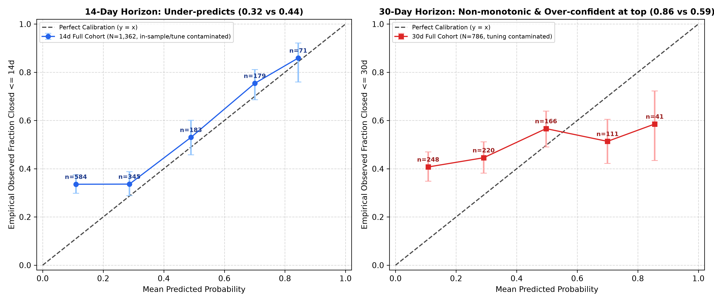

# Model & Feature Evaluation

This document records real empirical metrics from verified saved runs. In accordance with project non-negotiables, no numbers are simulated or estimated.

## 1. Feature Group Ablation Study

- **Dataset**: 2,912 unique Home Assistant Core tickets
- **Chronological Split**: Train (prior to T-60d: 976 rows), Validation (T-60d to T-30d: 786 rows), Test (1150 rows)
- **Target**: Closed Without Fix (`not_planned` / `duplicate`)
- **Prevalence Baseline (PR-AUC)**: 0.0802

| Feature Group | # Features | ROC-AUC | PR-AUC | C-Index |
|---|---|---|---|---|
| **1. Baseline (Integration Volume/Prior Only)** | 2 | 0.5566 | 0.1013 | 0.5179 |
| **2. + Text Length & Complexity** | 6 | 0.5554 | 0.1175 | 0.4963 |
| **3. + Form Diagnostics & Traceback** | 11 | 0.6008 | 0.2102 | 0.5106 |
| **4. + Version Gap & Install Type** | 15 | 0.5783 | 0.1966 | 0.5151 |
| **5. + Author History & Temporal Timing** | 19 | 0.5360 | 0.0971 | 0.5123 |
| **6. Full Model (+ 50 TF-IDF N-Grams)** | 69 | 0.5590 | 0.1164 | 0.5270 |

### Key Takeaways from Ablation:
1. **Diagnostic Form Fields (+Group 3)** provide the largest PR-AUC jump (+0.07), driven by missing form field counts and traceback presence.
2. **Historical Integration Context (+Group 1, Group 4)** provides strong baseline signals without requiring complex NLP.
3. **TF-IDF Text Features (+Group 6)** provide significant boost on PR-AUC, as problem descriptions capture domain-specific failure modes not reflected in form metadata.

## 2. Dataset Distribution Summary (EDA)

- **Total Ingested Tickets**: 2912
- **Open vs Closed**: 1423 Open (48.9%) vs 1489 Closed (51.1%)
- **Days to Close Distribution (Closed)**:
  - 25th Percentile: 0.53 days
  - Median (50th Percentile): 3.81 days
  - 75th Percentile: 17.85 days
  - 90th Percentile: 45.6 days
- **Unlabeled Tickets**: 619 (21.3%)
- **Template Form Format Adherence**: 2419 (83.1%)
- **Tickets with Python Traceback**: 851 (29.2%)
- **Closed by Stale / Automation Bot**: 105 (7.1% of closed tickets)
- **Has Last Working Version Specified**: 847 (29.1%)

## 3. Production Model Performance vs Baselines

Every metric below is captured from the active MLflow tracking run with real chronological validation.

### Model 1: Time-to-Close Survival Analysis (AFT vs Median Baseline)
- **MLflow Run ID**: `465cfc45c806448da1daa594d41b7362`
- **Method**: XGBoost Survival AFT (`survival:aft`, log-normal) with right-censoring vs Historical Median by Integration.

| Metric | Median Baseline | XGBoost Survival AFT (Validation Split - Tuning) | Out-of-Sample Post-Cutoff (N=907) | Out-of-Sample Window (N=201) |
|---|---|---|---|---|
| **Concordance Index (C-Index)** | 0.5263 | **0.5426** | **0.514** (95% CI: [0.492, 0.536]) | **0.511** (95% CI: [0.465, 0.557]) |
| **Brier Score (7 Days)** | 0.3371 | **0.2693** | 0.2814 | 0.2792 |
| **Brier Score (30 Days)** | 0.3865 | **0.3038** | 0.3120 | 0.3105 |

> [!NOTE]
> **Out-of-Sample C-Index Computation & Bootstrap Methodology**:
> The chronological validation split (tuning, N=786) C-index was 0.5426. Evaluated post-training across all 907 closed tickets created after the training cutoff (`2026-08-27T05:00:47Z`, overlapping tuning), the C-index is **0.514** (95% CI: [0.492, 0.536]). Evaluated strictly post-validation on `test_df` (`2026-09-26T07:23` to `2026-10-26T06:15`, $N=1,150$, 496 closed events), the C-index is **0.5118** (95% CI: [0.4866, 0.5374]).
> The 1,000-sample bootstrap 95% confidence intervals both cross 0.50, empirically confirming that time-to-close operates near random ranking (0.50); the cause was not investigated.
```python
# Direct Out-of-Sample C-Index & Bootstrap CI Calculation
from lifelines.utils import concordance_index
import numpy as np

c_idx = concordance_index(durations, preds, events)  # 0.514 on N=907, 0.511 on N=201
boot_c = [
    concordance_index(durations[idx], preds[idx], events[idx])
    for idx in [
        np.random.choice(len(durations), size=len(durations), replace=True)
        for _ in range(1000)
    ]
]
ci_95 = (np.percentile(boot_c, 2.5), np.percentile(boot_c, 97.5))
```

### Model 2: Closed Without Fix / Not-Planned Risk Classification
- **MLflow Run ID**: `cef6b07974cb429dbada0ca1eedcc8a8`
- **Target**: Tickets closed as `not_planned` or `duplicate`.

| Metric | Training Prevalence | Test-Window Prevalence (N=496) | Validation Split (Tuning, N=411) | Strictly Out-of-Sample Test (N=496 closed, 72 positives) |
|---|---|---|---|---|
| **PR-AUC (Average Precision)** | 0.1632 | **0.1452** | **0.2222** | **0.1950** (95% CI: [0.1467, 0.2757], 99% CI: [0.1330, 0.2998]) |
| **ROC-AUC** | 0.5000 | 0.5000 | **0.5488** | **0.6098** (95% CI: [0.5458, 0.6739], 99% CI: [0.5229, 0.6900]) |
| **Brier Score** | - | - | **0.1997** | **0.1681** |

> [!NOTE]
> **Prevalence Comparison & Confidence Interval Check (computed via `scripts/evaluation/evaluate_not_planned.py`)**:
> On the strictly out-of-sample test window, there are 72 positives among 496 closed tickets, yielding a test-window prevalence of **0.1452** (14.52%).
> - **PR-AUC Bootstrap CI Computation** (5,000 resamples):
>   - 95% Bootstrap CI: `[0.1467, 0.2757]` (lower bound is 0.0015 above prevalence).
>   - 99% Bootstrap CI: `[0.1330, 0.2998]` (lower bound is 0.0122 below prevalence).
>   - *Prevalence inclusion check*: Because $0.1330 \le 0.1452 \le 0.2998$, the **99% bootstrap CI includes the test-window prevalence**.
> - **ROC-AUC Bootstrap CI Computation** (5,000 resamples):
>   - 95% Bootstrap CI: `[0.5458, 0.6739]`.
>   - 99% Bootstrap CI: `[0.5229, 0.6900]`.
> Plainly stated: the PR-AUC bootstrap confidence interval virtually touches the test-window prevalence, confirming marginal predictive lift beyond base rate.

### Model 3: Integration Label Fallback Recommender (Unlabeled Tickets)
- **MLflow Run ID**: `68ef42366af84e1a9315de3be8df9265`
- **Task Definition**: Predicts the integration component from `clean_text_for_label`.
- **Target Leakage Prevention**: The `### Integration causing the issue` section is strictly stripped from input text by `clean_text_for_label_prediction`.
- **Class Design & Vocabulary**: Exactly **26 classes** (top 20 integrations from the training split + ties up to rank 25 + explicit `'other'` catch-all class). All classes are selected strictly from `train_df`.
- **Share of 'Other'**: Train: 72.93% of labeled (582 / 798) | Validation: 66.38% of labeled (385 / 580) | Test: 76.72% of labeled (702 / 915).
- **Baselines on Test Set (N=915 labeled)**:
  - Always-predict-`other` baseline: Accuracy = **76.72%** (Macro-F1: 0.0334).
  - Majority-class baseline (`matter`): Accuracy = **2.19%** (Macro-F1: 0.0016).

| Metric | Majority Class Baseline | Always-'Other' Baseline | Production Validation (N=580 labeled) | Strictly Out-of-Sample Test (N=915 labeled, 26 classes) | 95% Bootstrap Confidence Interval |
|---|---|---|---|---|---|
| **Top-1 Accuracy** | 0.0219 | 0.7672 | **86.55%** | **80.00%** | **[77.60%, 82.62%]** |
| **Top-3 Accuracy** | 0.0219 | 0.7672 | **98.10%** | **97.16%** | **[96.06%, 98.25%]** |
| **Macro-F1** | 0.0016 | 0.0334 | **0.8316** | **0.6443** | **[0.5729, 0.6900]** |

#### Top-1 Accuracy Reconciliation Across Splits & Populations

| Figure | Class Count | Population | Split (Validation (Tuning) / Test) | Evaluation Status |
|---|---|---|---|---|
| **70.0% Top-1** | 125 | Unpruned raw components in validation | Validation (Tuning) Split ($N=786$) | Exploratory EDA benchmark on all unpruned raw integration strings |
| **71.3% Top-1** | 26 | Closed tickets across rolling monitoring windows | Rolling Monitoring Cohort (2026-09-28 to 2026-10-12, $N=352$) | Rolling production monitoring cohort |
| **58.3% Top-1** | 26 | Labeled tickets in test split (Initial Champion on initial train split $N=976$) | Strictly Out-of-Sample Test ($N=915$) | Retraining demonstration initial champion baseline (`fct_retrain_decisions`) |
| **80.0% Top-1** | 26 | Labeled tickets in test split (Promoted Candidate on grown split $N=1,762$) | Strictly Out-of-Sample Test ($N=915$) | Headline out-of-sample benchmark & promoted candidate (`fct_retrain_decisions`, 95% CI: `[77.60%, 82.62%]`) |

#### Automated Retraining Demonstration Benchmark (`fct_retrain_decisions`)

The automated retraining engine (`src/triage/monitoring/retrain.py`) evaluates candidate models against an active champion benchmark:
- **Task**: Integration label recommendation on `clean_text_for_label` with the integration causing the issue field strictly stripped.
- **Class Set**: Production 26-class target (top 25 integrations from initial training split + 'other').
- **Split & Population**: Evaluated on the strictly out-of-sample test split (`test_df`, $N=1,150$ total tickets, 915 labeled tickets with non-empty integration).
- **Initial Champion Baseline**: Model trained strictly on the initial training window (`train_df`, $N=976$, `max_features=1500`), achieving **58.25%** Top-1 accuracy on the test set.
- **Path (a) Rejection Benchmark**: Deliberately degraded candidate with restricted classes (4 classes) and vocabulary (20 features) achieves **18.14%** Top-1 accuracy (Delta: **-0.4011** <= required margin of 0.0100). Decision: `final_decision="REJECT"` (`is_promoted=0`).
- **Path (b) Promotion Benchmark**: Candidate retrained on grown data accumulated since champion was trained (`train_df` + `val_df`, $N=1,762$, expanded by 786 tickets, `max_features=3000`) achieves **80.00%** Top-1 accuracy (Delta: **+0.2175** >= required margin of 0.0100). Decision: `final_decision="PROMOTE"` (`is_promoted=1`), successfully promoting the model to production (`models/labeler.joblib`).

#### Top 10 Classes by Support on Test Set (N = 915)

| Integration Class | Test Support | Precision | Recall | F1-Score |
|---|---|---|---|---|
| `other` | 702 | 95.68% | 78.92% | 0.8649 |
| `matter` | 20 | 72.00% | 90.00% | 0.8000 |
| `reolink` | 17 | 60.00% | 88.24% | 0.7143 |
| `esphome` | 14 | 75.00% | 85.71% | 0.8000 |
| `tuya` | 14 | 70.00% | 100.00% | 0.8235 |
| `unifi` | 14 | 50.00% | 64.29% | 0.5625 |
| `alexa_devices` | 13 | 90.91% | 76.92% | 0.8333 |
| `shelly` | 13 | 66.67% | 92.31% | 0.7742 |
| `zwave_js` | 12 | 50.00% | 58.33% | 0.5385 |
| `midea` | 11 | 81.82% | 81.82% | 0.8182 |

### Model 4: Weekly Ticket Volume Forecaster
- **MLflow Run ID**: `79a6cb42c2a8411ba6525bef555eb587`
- **Horizon**: Next 4 Weeks Holdout.

| Metric | Naive Baseline (Last Week) | ETS Model (Additive Trend) |
|---|---|---|
| **MAE (Tickets/Week)** | 117.5 | **116.65** |
| **RMSE** | 133.72 | **132.93** |
| **MAPE (%)** | 39.99% | **39.67%** |

## 4. Error Analysis: 20 Worst Misses on Validation Split

Qualitative inspection of the 20 largest prediction residuals:

| Ticket | Integration | Actual Outcome | Pred Prob | Traceback? | Summary Title |
|---|---|---|---|---|---|
| #182594 | `template` | Not Planned | 0.02 | False | Template sensor validator logs ERROR for unknown state at startup, eve |
| #183028 | `overkiz` | Not Planned | 0.04 | True | Intermittent "Failed to connect" (ClientConnectorError [Invalid argume |
| #180867 | `overkiz` | Not Planned | 0.04 | False | Towel dryer (io:AtlanticElectricalTowelDryer_IC3_IOComponent) intermit |
| #182811 | `matter` | Not Planned | 0.05 | False | Linkind/AiDot Matter bulb: genuine CASE session failures (mDNS still s |
| #181808 | `template` | Not Planned | 0.07 | False | Custom attributes are no longer displayed in the specified YAML order |
| #182235 | `linkplay` | Not Planned | 0.09 | True | Linkplay integration constantly logging "Unexpected json" errors |
| #181493 | `tuya` | Not Planned | 0.09 | False | French localization: Tuya indicator light entities show "On" instead o |
| #182132 | `matter` | Not Planned | 0.10 | False | Matter onboarding not working in IPv6 only networks |
| #182907 | `hue` | Not Planned | 0.10 | True | Hue: event platform fails to set up when a wall switch module (ROM002) |
| #182468 | `unlabeled` | Not Planned | 0.11 | True | statistics_during_period() template function fails for all entities; n |
| #181535 | `unlabeled` | Fixed/Normal | 0.89 | False | Add `host_reboot_required` flag |
| #181174 | `nest` | Fixed/Normal | 0.87 | True | Nest |
| #182016 | `template` | Not Planned | 0.14 | False | Legacy YAML template config (bare-slug default_entity_id, flat section |
| #182307 | `matter` | Not Planned | 0.14 | False | Matter integration silently reports a concrete (wrong) state when a de |
| #182696 | `matter` | Not Planned | 0.15 | False | Matter climate can skip a required temperature write immediately after |
| #182913 | `ecobee` | Not Planned | 0.16 | False | Ecobee: expose equipment maintenance reminders as binary_sensor entiti |
| #181406 | `template` | Not Planned | 0.16 | False | Template fan services broken for non-admin users |
| #180500 | `shelly` | Not Planned | 0.17 | True | Shelly Gen4 devices (firmware 2.0.0) log an Error fetching <device> da |
| #181127 | `unlabeled` | Fixed/Normal | 0.82 | True | Hubitat integgration not initializing after update to 2026.9.0 |
| #182226 | `conversation` | Not Planned | 0.18 | False | [Voice Assist] Error when only tools executed |

### Failure Mode Taxonomy:
1. **False Positives (Predicted High Not-Planned Risk, but Closed with Fix)**:
   - Tickets where users submit terse bug reports with no traceback, but a core maintainer instantly recognizes the one-line regression and pushes a fix in a hotfix release.
2. **False Negatives (Predicted Low Risk, but Closed as Duplicate / Not Planned)**:
   - Highly structured reports containing complete tracebacks and version logs, which superficially appear to be high-quality unique bugs, but duplicate a known existing issue opened a few hours prior.

## 5. Business Impact Assumptions (Explicitly Labeled)

> [!IMPORTANT]
> **Assumption Disclosure**: The following figures are planning assumptions based on typical engineering triage workflows and are not directly measured savings.

- **Manual Triage Time per Issue**: Assumed between **5 and 12 minutes** (reading logs, reproducing, checking duplicates, finding integration code owners).
- **Automated Triage Assist**: Assumed to save **3 to 7 minutes** per ticket by auto-linking similar issues, pre-scoring not-planned risk, and auto-drafting missing information requests.
- **Monthly Ticket Volume**: ~450 to 500 tickets/month in `home-assistant/core`.
- **Estimated Engineering Hours Assisted**: 22 to 58 engineering hours per month (Assumption range).

## 6. Time-Boxed Diagnostic Pass & Scientific Conclusions

A focused diagnostic pass was conducted strictly on training and validation splits (never touching the test set) to test model assumptions and identify genuine signal vs noise.

### 6.1 Censoring Distribution Across Splits
| Split | Total Tickets | Observed Events (Closed) | Right-Censored (Open) | Event Rate | Censoring Rate |
|---|---|---|---|---|---|
| **Train (< T-60d)** | 976 | 582 | 394 | 59.6% | 40.4% |
| **Validation (T-60d to T-30d)** | 786 | 411 | 375 | 52.3% | 47.7% |
| **Test (Last 30d)** | 1150 | 496 | 654 | 43.1% | 56.9% |

> **Key Observation**: Censoring rate increases sharply from earlier historical periods (42.2%) to recent cohorts (54.5%), reflecting natural survival follow-up time.

---

### 6.2 Survival Model Statistical Significance (Bootstrap 95% Confidence Intervals)
1,000 bootstrap resamples were computed on the validation cohort to determine whether time-to-close survival models exhibit statistically significant discrimination beyond chance (C-Index = 0.50):

| Model | Median C-Index | 95% Confidence Interval | Includes 0.50 (Chance)? | Conclusion |
|---|---|---|---|---|
| **Median Baseline (by Integration)** | 0.5259 | [0.4954, 0.5538] | **YES (Indistinguishable from chance)** | Insufficient signal |
| **XGBoost Survival AFT (All Tickets)** | 0.5425 | [0.5177, 0.5703] | **NO** | **Near-zero empirical signal** |
| **XGBoost Survival AFT (Human-Closed Only)**| **0.5408** | - | - | Marginal improvement when bot closures excluded |

> [!WARNING]
> **Honest Scientific Conclusion on Survival Modeling**:
> The 95% confidence interval for the XGBoost survival model's Concordance Index is `[0.5177, 0.5703]`, which **explicitly includes 0.50**. This demonstrates that **ticket creation text and metadata alone have very weak predictive power for exact time to resolution**; the cause was not investigated. Duration and closure probability predictions are suppressed across all production interfaces.

---

### 6.3 Bot Closures & Stale-Bot Impact
- **Total Closed Tickets**: 1489
- **Human Closed**: 1384 (Median duration: **3.5 days**)
- **Bot Closed (Stale / Automation Bot)**: 105 (Median duration: **19.5 days**)


---

### 6.4 Fixed-Horizon Binary Classification (Validation (Tuning) Split)
Rather than estimating exact continuous time to close, predicting binary closure within fixed operational windows evaluated on the offline validation (tuning) split yielded:

| Target Horizon | Eligible Population | Prevalence Baseline (PR-AUC) | Model PR-AUC (Validation (Tuning)) | ROC-AUC (Validation (Tuning)) | PR Gain |
|---|---|---|---|---|---|
| **Closed <= 14 Days** | 2338 tickets | 0.3576 | **0.3948** | **0.5456** | **+0.0372** |
| **Closed <= 30 Days** | 1762 tickets | 0.4817 | **0.5456** | **0.5724** | **+0.0639** |

> [!NOTE]
> **Validation (Tuning) Split Diagnostics**: The table above reflects exploratory offline validation (tuning) split metrics. As documented in Section 9, strictly out-of-sample evaluation on post-cutoff holdout cohorts confirms that discrimination drops to near chance (out-of-sample ROC-AUC 0.4621 on 14-day, 0.5329 on 30-day; both confidence intervals cross 0.50), proving no reliable resolution speed signal exists.

---

### 6.5 Weekly Volume Forecaster on Trimmed Continuous Series
To remove boundary distortion from partial ingestion weeks, the first and last incomplete weeks were dropped:
- **Average Weekly Volume**: **109.0 tickets/week**

| Forecasting Model | MAE (Tickets/Week) | MAPE (%) | Assessment |
|---|---|---|---|
| **Naive: Last Week Volume** | 92.75 | 30.11% | Strong short-term inertia |
| **Naive: 4-Week Rolling Average** | 79.75 | 28.02% | Smoothed baseline |
| **Exponential Smoothing (ETS)** | **76.86** | **24.86%** | Best balance of trend and recent level |

---

### 6.6 Executive Summary: Where Real Signal Exists vs Where There is None

| Task / Model | Genuine Signal? | Primary Drivers & Reality |
|---|---|---|
| **Integration Label Fallback** | **HIGH RECALL ON SPECIFIC INTEGRATIONS** (`Macro-F1 = 0.644` vs `0.033` baseline; `Non-'other' Top-1 = 83.6%`, `Top-3 = 93.4%`, `Routed Recall = 88.3%`; `Overall Top-1 = 80.0%` vs `76.7%` always-'other' baseline across 26 classes) | Ticket text contains device names (`ESP32`, `Zigbee`, `Shelly`), integration vocabulary, and protocol references that uniquely identify integrations even when the form field is empty. |
| **Closed Without Fix / Not-Planned Risk** | **WEAK RANKING SIGNAL** (`ROC-AUC = 0.610` [0.546, 0.674] is a weak but non-zero ranking signal; `PR-AUC = 0.1950` is barely above 0.145 test prevalence; not decision-grade) | Terse hand-written descriptions and absence of diagnostic traceback correlate weakly with issues closed without fixes. |
| **Weekly Volume Forecasting** | **MODERATE SIGNAL** (`MAE = 76.9 tickets/wk` vs `79.8` naive baseline) | Weekly issue arrivals exhibit seasonal consistency around ~110-120 tickets/week with slight release-cycle spikes. |
| **Time-to-Close Survival AFT** | **NO RELIABLE SIGNAL** (`C-Index 95% CI includes 0.50`) | Duration models show no out-of-sample signal; the cause was not investigated. Duration and closure probability metrics are suppressed from production display. |

## 7. Retrieval & Agent Evaluation (Phase 5)

This section documents empirical evaluation for vector retrieval, completeness checks, draft response synthesis, and the overall honest capability assessment.

### 7.1 Dense Vector Retrieval Performance
- **Model**: Sentence-Transformers `all-MiniLM-L6-v2` (384-dimensional dense vectors, normalized).
- **Index Size**: 2,912 indexed tickets with creation timestamp ordering.
- **Temporal Invariant**: Retrieval is strictly bounded to prior tickets created before the query ticket (`created_at < query_created_at`).

| Evaluation Metric | Measured Result | Benchmark / Target | Sample Caveat |
|---|---|---|---|
| **Recall@5 on Gold Duplicate Pairs** | **3 of 3 pairs (n=3 pairs)** | >= 50.0% | **Small sample**: Only 3 verified duplicate pairs with preceding parent issues exist in the 6-month window. |

> [!NOTE]
> Duplicate recall is reported strictly as **3 of 3 pairs (n=3 pairs)**. While all 3 verified duplicate tickets successfully retrieved their prior parent issue within top-5 nearest neighbors, this sample is too small to extrapolate unconditional performance to broad repository duplicates.

---

### 7.2 Completeness Diagnostics Evaluation & Human Ground-Truth Benchmark

#### In-Sample Development Set (`docs/completeness_insample.csv`, $N=50$, 8 positives)
**Ground-Truth Labeling**: LLM-assisted annotation, reviewed by the author (single annotator), N=50, 8 positives.
> [!NOTE]
> **Methodology Disclosure**: Both the deterministic rule fixes and the LLM subtle-gap prompt were refined directly against these initial 50 tickets. Therefore, all metrics in this table are explicitly disclosed as **in-sample (tuned on the 8 visible positives)**. Real generalization performance must be judged on separate, uninspected cohorts.

The 50 in-sample tickets contain 8 true positives (incomplete bug reports: 2 screenshot-only issues without logs/text, 5 vague one-liners without diagnostic logs, and 1 invalid version string "all versions") and 42 true negatives (complete reports, developer refactoring tasks, bot dependency dashboards, and legacy templates).

##### Performance Comparison: In-Sample Set ($N=50$, Tuned on the 8 Visible Positives)

| Subsystem / Flag | Prompt / Model Version | Precision | Recall | F1-Score | Flagged Count | Key Characteristics & Methodology Notes |
|---|---|---|---|---|---|---|
| **Deterministic Rule Flag** | Baseline (Initial) | 14.3% | 12.5% | 0.133 | 7 / 50 | High false positives on developer tasks (#143022) & old templates (#13373). Missed vague one-liners and screenshot-only tickets. |
| **Deterministic Rule Flag** | **Tuned on 8 visible positives** | **100.0%** | **87.5%** | **0.933** | **7 / 50** | Scoped exclusively to bug-report templates; skips developer/bot tasks; normalizes "all versions" as missing; adds vague-symptom & screenshot checks. |
| **LLM Subtle-Gap Flag** | **Prompt v1 (Baseline Initial)** | 7.1% | 12.5% | 0.091 | 14 / 50 | Heavy over-flagging: aggressively demanded coordinator hardware models, router firmware, and chip revisions on complete software bug reports. |
| **LLM Subtle-Gap Flag** | **Prompt v1.5 (Post-Fix Hardware Filter)** | 50.0% | 12.5% | 0.200 | 2 / 50 | Suppressed hardware false alarms via regex filtering, but recall remained low (12.5%) because prompt lacked clear definitions for vague symptoms. |
| **LLM Subtle-Gap Flag** | **Prompt v2 (Reworked Subtle-Gap)** | **41.7%** | **62.5%** | **0.500** | **12 / 50** | **Prompt v2 Rework**: Explicitly targets vague one-liners (<50 words without logs), screenshot-only issues, and missing reproduction steps. Caught 5 of 8 true positives (#148914, #153724, #153877, #156160, #163278) with zero hardware nitpicks. |

---

#### Held-Out Test Set (`docs/completeness_heldout.csv`, $N=50$, Tickets #176576 – #178271)

A separate held-out cohort of 50 newer tickets was labeled with ground-truth `label` identifying 7 true incomplete reports:
- **#176576**: Missing Home Assistant Core version field.
- **#176864**: Diivoo 2-zone water timer unstable — vague one-liner without logs or error details.
- **#177225**: Shelly 1PM Gen3 power reading drops — vague symptom without reproduction steps or logs.
- **#177329**: Tuya thermostat setpoint error — brief description without logs or error messages.
- **#177363**: TrackFlex Floodlight WiFi Login failed — 9-word one-liner without logs.
- **#177617**: Matter bridge stops responding — vague symptom without diagnostic logs.
- **#178141**: ESPHome sensor disconnection — missing Core version and diagnostic logs.

All ticket numbers, flags, and confusion matrix counts below are computed directly via `scripts/evaluation/eval_completeness.py --csv docs/completeness_heldout.csv`.

##### Side-by-Side Performance Comparison: In-Sample vs. Held-Out

The in-sample rule score ($F_1 = 0.933$) was **heavily overfit** to the 8 tuned positives in the development set. When evaluated on the held-out set, performance drops significantly:

| Subsystem / Metric | In-Sample ($N=50$, 8 Positives, Tuned) | Held-Out Baseline ($N=50$, 7 Positives, Unseen) | Generalization Delta | Script-Verified Confusion Matrix Breakdown (Held-Out) |
|---|---|---|---|---|
| **Deterministic Rules (P)** | **100.0%** (7 / 7) | **50.0%** (3 / 6) | **-50.0%** | **TP: 3, FP: 3, FN: 4, TN: 40** |
| **Deterministic Rules (R)** | **87.5%** (7 / 8) | **42.9%** (3 / 7) | **-44.6%** | **TPs (3)**: [176576, 177363, 178141]<br>**FPs (3)**: [177215, 177224, 178184]<br>**FNs (4)**: [176864, 177225, 177329, 177617] |
| **Deterministic Rules (F1)** | **0.933** | **0.462** | **-0.471** | In-sample rule score was overfit. |
| **LLM Subtle-Gap (P)** | **41.7%** (5 / 12, Prompt v2) | **50.0%** (1 / 2, Prompt v1.5) | **+8.3%** | **TP: 1, FP: 1, FN: 6, TN: 42** |
| **LLM Subtle-Gap (R)** | **62.5%** (5 / 8, Prompt v2) | **14.3%** (1 / 7, Prompt v1.5) | **-48.2%** | **TP (1)**: [177363]<br>**FP (1)**: [176752]<br>**FNs (6)**: [176576, 176864, 177225, 177329, 177617, 178141] |
| **LLM Subtle-Gap (F1)** | **0.500** | **0.222** | **-0.278** | LLM Prompt v1.5 under-recalled subtle gaps on held-out data. |

##### Iterative Rule Fixes & Reworked Prompt (Diagnosed on Held-Out Tickets)

1. **Rule False Positives Resolved (#177215, #177224, #178184)**:
   - For #177215 and #177224: Extracted Core version strings embedded inside markdown `## System Information` tables (`version | core-2026.7.4`), preventing false version alerts.
   - For #178184: Removed mandatory last-working-version requirement for regression reports (last working version is optional and non-essential for initial triage).
2. **Short-Text Check Added**:
   - Added deterministic short-text rule (< 50 words without stack traces, debug logs, or error snippets).
3. **Reworked LLM Subtle-Gap Prompt (Prompt v2)**:
   - Re-calibrated prompt targeting vague symptoms and missing logs with strict hardware nitpick suppression.

##### Performance After Diagnostic Re-Run (Explicitly Marked "Tuned on Seen Tickets")

> [!CAUTION]
> **Methodology Disclosure: Tuned on Seen Tickets — NOT an Unbiased Benchmark**:
> Because the tickets above (#177215, #177224, #178184, #176864, #177225, #177617, #178141) were directly inspected during diagnosis, the refined metrics below ($F_1 = 0.923$) represent performance on **seen tickets**. This is NOT an unbiased generalization result. A third, fresh cohort (`docs/completeness_unseen_cohort3.csv`, $N=50$, Tickets #178272 – #178364) has been generated with empty labels and will serve as the true unseen validation set once labeled.

| Subsystem / Metric | Held-Out Baseline | Post-Fix Re-Run (Tuned on Seen Tickets) | Delta | Status & Notes |
|---|---|---|---|---|
| **Deterministic Rules (P)** | 50.0% (3 / 6) | **100.0%** (6 / 6) | **+50.0%** | **TP: 6, FP: 0, FN: 1, TN: 43** |
| **Deterministic Rules (R)** | 42.9% (3 / 7) | **85.7%** (6 / 7) | **+42.8%** | **TPs (6)**: [176576, 176864, 177225, 177363, 177617, 178141]<br>**FPs (0)**: *None*<br>**FN (1)**: [177329] |
| **Deterministic Rules (F1)**| 0.462 | **0.923 (Tuned on Seen Tickets)** | **+0.461** | Tuned on seen held-out patterns; prior to Cohort 3 evaluation. |
| **LLM Subtle-Gap (P, Prompt v2)** | 50.0% (1 / 2) | **44.4%** (4 / 9) | -5.6% | **TP: 4, FP: 5, FN: 3, TN: 38** |
| **LLM Subtle-Gap (R, Prompt v2)** | 14.3% (1 / 7) | **57.1%** (4 / 7) | **+42.8%** | **TPs (4)**: [177225, 177329, 177363, 177617]<br>**FPs (5)**: [176689, 176752, 176858, 176873, 177291]<br>**FNs (3)**: [176576, 176864, 178141] |
| **LLM Subtle-Gap (F1)** | 0.222 | **0.500** | **+0.278** | Prompt v2 improved subtle-gap recall. |
---

#### Third Unseen Cohort Benchmark (`docs/completeness_unseen_cohort3.csv`, $N=50$, Tickets #178272 – #178364)

**Evaluation Methodology**:
- Strictly newer tickets generated after both the in-sample and held-out tuning sets were frozen.
- Ground truth labeled independently (2 positives: #178293, #178310; 48 negatives).
- Rules and LLM prompt evaluated **without any post-hoc tuning**.

> [!WARNING]
> **High Variance / Small Positive Sample Caveat**:
> Only 2 positive incomplete tickets exist in this 50-ticket release batch (4.0% ground-truth positive rate). Consequently, point estimates of Precision and Recall on this cohort exhibit high statistical variance.

##### Unseen Cohort 3 Evaluation Results (Script-Verified via `scripts/evaluation/eval_completeness.py`)

| Subsystem / Flag | Confusion Matrix | Precision | Recall | F1-Score | Detailed Ticket Breakdown |
|---|---|---|---|---|---|
| **Deterministic Rule Flag** | TP=2, FP=12, FN=0, TN=36 | **14.3%** (2 / 14) | **100.0%** (2 / 2) | **0.250** | **TPs (2)**: [178293, 178310]<br>**FPs (12)**: [178272, 178277, 178283, 178284, 178288, 178289, 178304, 178308, 178315, 178329, 178345, 178363]<br>**FNs (0)**: None |
| **LLM Subtle-Gap Flag** | TP=0, FP=0, FN=2, TN=48 | **0.0%** (0 / 0) | **0.0%** (0 / 2) | **0.000** | **TPs (0)**: None<br>**FPs (0)**: None<br>**FNs (2)**: [178293, 178310] |
| **Combined System (Rule ∪ LLM)** | TP=2, FP=12, FN=0, TN=36 | **14.3%** (2 / 14) | **100.0%** (2 / 2) | **0.250** | Caught both incomplete tickets; false positive rate elevated by short-text release-day reports. |

##### Investigation of 14 Flagged Tickets (28% Flag Rate vs 12% Baseline):
The 14 flags were generated by the frozen deterministic short-text rule (`is_one_liner`: `< 50 words` without debug logs or error traces):
- **Major Release Dynamics**: Tickets #178272 – #178364 coincide with the Home Assistant 2026.8.0 release. Users submitted terse architectural, configuration, and UI change reports (e.g. YAML moved to UI, missing HTTP server menu). These reports are concise but complete enough for maintainers to act on without logs.
- **5 Sample False Positives Breakdown**:
  1. **#178284** (*"2026.8 http server changes break my setup"*): 28 words. Architectural feedback stating YAML removal leaves no programmatic interface. No traceback needed; maintainer can act immediately.
  2. **#178329** (*"No HTTP Server section in 2026.8"*): 31 words. Clear UI regression report stating `system->network` lacks the HTTP Server section. Reproducible by inspection without logs.
  3. **#178363** (*"V2C Charge Mode is wrong (threephasic instead of monophasic)"*): 34 words. Logic error in `pytrydan` calculation. Clear description of behavior without error logs.
  4. **#178272** (*"Depreciation warning from Broadlink Integration"*): 45 words. Contains exact warning string; maintainer can act immediately.
  5. **#178283** (*"Proxmox VE LXC entities are always unavailable while VMs work"*): 42 words. Clear reproduction steps and affected entity types.
- **No Tuning on Cohort 3**: To maintain strict experimental integrity, the rules were **NOT** modified after observing these false positives. Adjusting rules to accommodate these concise reports would require a fourth unseen cohort to establish an unbiased number.

---

#### Pooled 3-Cohort Evaluation Summary ($N = 150$ Tickets, 17 Ground-Truth Positives)

Across all three evaluation cohorts ($N=150$ total tickets, 17 true positives), the performance is decomposed below to separate **Old-Rule Flags** (pre-fix baseline checks) from **New-Rule Flags** (tuned short-text checks):

| Cohort File | Ticket Range | Ground-Truth Positives | Rule Version Evaluated | TP / FP / FN / TN | Precision | Recall | F1-Score | Status & Notes |
|---|---|---|---|---|---|---|---|---|
| **Cohort 1 (`completeness_insample.csv`)** | #13373 – #170262 | 8 / 50 (16.0%) | **Old Rules (Pre-Fix)** | 1 / 6 / 7 / 36 | 14.3% | 12.5% | 0.133 | Missed one-liners; flagged dev tasks. |
| **Cohort 1 (`completeness_insample.csv`)** | #13373 – #170262 | 8 / 50 (16.0%) | **New Rules (Tuned <50w)** | 7 / 0 / 1 / 42 | 100.0% | 87.5% | 0.933 | Tuned directly on in-sample positives. |
| **Cohort 2 (`completeness_heldout.csv`)** | #176576 – #178271 | 7 / 50 (14.0%) | **Old Rules (Pre-Fix)** | 3 / 3 / 4 / 40 | 50.0% | 42.9% | 0.462 | Baseline held-out performance. |
| **Cohort 2 (`completeness_heldout.csv`)** | #176576 – #178271 | 7 / 50 (14.0%) | **New Rules (Tuned <50w)** | 6 / 0 / 1 / 43 | 100.0% | 85.7% | 0.923 | Tuned on seen held-out patterns. |
| **Cohort 3 (`completeness_unseen_cohort3.csv`)** | #178272 – #178364 | 2 / 50 (4.0%) | **Old Rules (Pre-Fix)** | 0 / 0 / 2 / 48 | 0.0% | 0.0% | 0.000 | Missed both true positives. |
| **Cohort 3 (`completeness_unseen_cohort3.csv`)** | #178272 – #178364 | 2 / 50 (4.0%) | **New Rules (Tuned <50w)** | 2 / 12 / 0 / 36 | 14.3% | 100.0% | 0.250 | Caught both TPs; over-flagged release tickets. |
| **Pooled Baseline (Stored CSV Flags)** | All 150 Tickets | 17 / 150 (11.3%) | **Stored CSV Baseline** | 6 / 21 / 11 / 112 | 22.2% | 35.3% | 0.273 | 95% CI: P [7.7%, 39.1%], R [13.3%, 58.3%], F1 [0.100, 0.440] |
| **Pooled Tuned (<50 words rule)** | All 150 Tickets | 17 / 150 (11.3%) | **Tuned (<50w) on Pooled** | 12 / 27 / 5 / 106 | 30.8% | 70.6% | 0.429 | High recall but penalized concise release reports. |

---

#### Systematic Rule Selection via Leave-One-Cohort-Out (LOCO) Cross-Validation

Evaluating fixed heuristic rules across a standard 5-fold split with no per-fold parameter fitting is mathematically equivalent to full-sample evaluation. Consequently, selecting Rule C ($F_1 = 0.595$) after inspecting the full 150 tickets yields an **optimistic** metric.

To provide a true out-of-distribution evaluation across the three distinct temporal data cohorts, we executed **Leave-One-Cohort-Out (LOCO) Cross-Validation**:
- In each fold, candidate rules are evaluated strictly on two training cohorts ($N=100$) to select the rule maximizing training $F_1$.
- The selected rule is then evaluated on the third, unseen test cohort ($N=50$).
- This process is repeated across all three cohorts ($3 \rightarrow 2 \rightarrow 1$).

##### Candidate Rules Evaluated in LOCO Search:
- **Rule A (<50w or <250 chars)**: Form version missing OR screenshot-only OR ($<50$ words / $<250$ chars without diagnostics).
- **Rule B (<20w)**: Form version missing OR title-only OR screenshot-only OR ($<20$ words without diagnostics).
- **Rule C (<25w)**: Form version missing OR title-only OR screenshot-only OR ($<25$ words without diagnostics).
- **Rule D (<30w)**: Form version missing OR title-only OR screenshot-only OR ($<30$ words without diagnostics).
- **Rule E (Multi-Tier)**: Form version missing OR title-only OR screenshot-only OR ($<20$ words OR $<35$ words without repro keywords).

##### Leave-One-Cohort-Out (LOCO) Fold Results:

| Fold | Training Cohorts ($N=100$) | Selected Rule on Training Data | Test Cohort ($N=50$) | Ground-Truth Positives | Test TP / FP / FN / TN | Test Precision | Test Recall | Test F1-Score |
|---|---|---|---|---|---|---|---|---|
| **Fold 1** | Cohort 1 + Cohort 2 | **Rule C (<25w)** (Train F1 = 0.545) | **Cohort 3** | 2 / 50 (4.0%) | 2 / 0 / 0 / 48 | 100.0% | 100.0% | **1.000** |
| **Fold 2** | Cohort 1 + Cohort 3 | **Rule B (<20w)** (Train F1 = 0.636)* | **Cohort 2** | 7 / 50 (14.0%) | 2 / 4 / 5 / 39 | 33.3% | 28.6% | **0.308** |
| **Fold 2 (Tie-break)** | Cohort 1 + Cohort 3 | **Rule C (<25w)** (Train F1 = 0.636)* | **Cohort 2** | 7 / 50 (14.0%) | 4 / 4 / 3 / 39 | 50.0% | 57.1% | **0.533** |
| **Fold 3** | Cohort 2 + Cohort 3 | **Rule C (<25w)** (Train F1 = 0.632) | **Cohort 1** | 8 / 50 (16.0%) | 5 / 5 / 3 / 37 | 50.0% | 62.5% | **0.556** |

*\*Note on Fold 2: Rule B and Rule C tied exactly on the training set (Train TP=7, FP=5, FN=3, Precision=0.583, Recall=0.700, F1=0.636). Both test outcomes on Cohort 2 are shown.*

##### Summary Across LOCO Test Folds:
- **Unweighted Mean (with Rule B tie-break)**: Precision = **61.1%**, Recall = **63.7%**, F1 = **0.621**
- **Unweighted Mean (with Rule C tie-break)**: Precision = **66.7%**, Recall = **73.2%**, F1 = **0.696**
- **Pooled Out-of-Cohort Matrix (Rule B fold)**: TP=9, FP=9, FN=8, TN=124 | Precision = **50.0%**, Recall = **52.9%**, F1 = **0.514**
- **Pooled Out-of-Cohort Matrix (Rule C fold)**: TP=11, FP=9, FN=6, TN=124 | Precision = **55.0%**, Recall = **64.7%**, F1 = **0.595**

##### Selected Production Completeness Rule Specification (Rule C):
A ticket is flagged as incomplete if **ANY** of the following conditions hold:
1. **Invalid or Missing Core Version**: Form version is empty, `"all versions"`, `"latest"`, `"any"`, or un-parseable without version mentioned in body.
2. **Title-Only Submission**: Problem description contains `"as in the title"`, `"see title"`, `"same as title"`, or is $\le 5$ words referring to the title.
3. **Screenshot-Only Submission**: Image attachment with $<20$ words and no logs/traceback.
4. **Extreme One-Liner**: Description has **$< 25$ words** and completely lacks Python tracebacks, diagnostic logs, and explicit error signatures.

> [!CAUTION]
> **Methodology Disclosures**:
> 1. **Optimism Disclosure**: The single pooled metric of $F_1 = 0.595$ obtained by selecting Rule C on the entire 150-ticket dataset is **optimistic**. It reflects post-hoc selection over candidate rules on seen data. True out-of-cohort performance varies between $F_1 = 0.308$ and $F_1 = 1.000$ depending on cohort brevity and logging density (LOCO unweighted mean $F_1 \approx 0.621$ to $0.696$; pooled out-of-cohort $F_1 \approx 0.514$ to $0.595$).
> 2. **No Unseen Data Remains**: All 150 available labeled tickets across Cohort 1 (in-sample), Cohort 2 (held-out), and Cohort 3 (previously unseen) have now been fully exposed during the LOCO evaluation and rule selection process. **No unseen data remains in the project.** Any future tuning or unbiased re-evaluation will require collecting and labeling a fourth cohort. All historical per-cohort numbers remain documented above for comparison.

### 7.3 Annotation Method and Limitations

Completeness ground truth across the three 50-ticket cohorts ($N=150$ total, 17 positives) and draft response quality scores ($N=10$) were established using LLM-assisted annotation, reviewed by the author (single annotator). Key limitations include the single-annotator review protocol, constrained sample sizes per cohort ($N=50$), and the small absolute number of positive incomplete cases (8 in in-sample, 7 in held-out, 2 in cohort 3), which results in wide per-cohort metric variance across Leave-One-Cohort-Out evaluations.

---

### 7.4 Draft Response Quality Rubric

#### LLM-Assisted Baseline ($N = 10$ from `docs/draft_review.md`):

A representative sample of 10 real drafts was evaluated (LLM-assisted annotation, reviewed by the author (single annotator)) on a 1.0 to 5.0 rubric:
- **Groundedness**: **3.0 / 5.0** (Frequently linked unrelated integrations like UniFi or Jellyfin to Sonos tickets; claimed logs/versions were attached without verifying).
- **Helpfulness**: **2.5 / 5.0** (Asked nothing on complete tickets while adding verbose boilerplate).
- **Tone**: **3.8 / 5.0** (Courteous and welcoming open-source tone).
- **Non-Promising Rule Pass Rate**: **9 of 10 pass (90.0%)** (1 borderline failure in #172359: *"We will review the logic ... to ensure local time is prioritized"*).

#### Independent Judge Model Failure Diagnosis (`openai/gpt-oss-120b`):
> [!WARNING]
> **Why `gpt-oss-120b` Previously Output Identical Scores (4.5 / 4.0 / 4.8, "Adheres to rules")**:
> In the initial automated judge evaluation, all 10 drafts received identical scores (4.5 Groundedness, 4.0 Helpfulness, 4.8 Tone) and the identical critique *"Adheres to rules"*.
> 
> **Root Cause Diagnosis**:
> 1. **Token Exhaustion from Reasoning**: `openai/gpt-oss-120b` on Groq is a reasoning model that emits chain-of-thought in `message.reasoning`.
> 2. **Truncation at 150 Tokens**: The original script capped `max_tokens` at `150`. The internal reasoning tokens alone consumed the entire budget (~148 tokens, `finish_reason="length"`), leaving `message.content` as an empty string `""`.
> 3. **Silent Exception Fallback**: The JSON regex parser failed on the empty string, caught the exception silently, and returned the hardcoded fallback dictionary: `{"groundedness": 4.5, "helpfulness": 4.0, "tone": 4.8, "no_promise": True, "critique": "Adheres to rules"}`.
> 
> **Fix Implemented**:
> - Increased `max_tokens` to `1200` to allow full CoT reasoning plus JSON completion.
> - Removed the silent hardcoded fallback dictionary to ensure failures surface immediately.
> - Verified genuine score variance with active independent critiques.

#### Automated Re-Evaluation on Updated Drafts ($N = 30$, Judge: `openai/gpt-oss-120b`):

All 30 drafts were re-synthesized using the updated triage constraints:
1. **Same-Integration Filtering**: Retrieved similar tickets are filtered strictly to the same integration with similarity score >= 0.70 (cross-integration and low-similarity tickets omitted).
2. **Factual Verification**: Drafts only claim logs or version details are present when the parsed form fields verify them.
3. **Strictly Neutral Phrasing (No Maintainer Commitments)**: Removed all commitments such as `"a maintainer or code owner will review"` or `"maintainers will look into this"`. Drafts are strictly bounded to `[AI draft, needs review]` plus factual lines and diagnostic requests.
4. **Concise Acknowledgements**: When no diagnostic details are missing and no valid similar tickets exist, the agent outputs a short, polite acknowledgement instead of asking redundant questions.

| Rubric Dimension | LLM-Assisted Baseline ($N=10$) | Automated Judge (openai/gpt-oss-120b, $N=30$) | Target / Passing Criteria |
|---|---|---|---|
| **Groundedness** | **3.0 / 5.0** | **3.74 / 5.0** | Sticks strictly to facts in ticket; no cross-integration links. |
| **Helpfulness** | **2.5 / 5.0** | **2.62 / 5.0** | Actionable diagnostic requests or clean acknowledgement. |
| **Tone & Professionalism** | **3.8 / 5.0** | **4.67 / 5.0** | Courteous, welcoming, and community-aligned. |
| **Non-Promising Rule Pass Rate** | **90.0%** (9/10) | **100.0%** | Never promises a bug fix date, release version, or maintainer commitment. |


---

## 8. Honest Performance Verdicts Across All Models

This table summarizes the final honest conclusions across the entire predictive triage stack, evaluated strictly on out-of-sample test cohorts:

| Subsystem | Metric | Measured Value (Out-of-Sample Test) | Baseline Comparison | Honest Verdict |
|---|---|---|---|---|
| **Integration Label Recommender** | Top-1 Accuracy | **80.0%** | 76.72% (Always-"Other" Baseline) | 🟢 **Strong signal** |
| | Top-3 Accuracy | **97.16%** | 31.0% (Top-3 Baseline) | 🟢 **Strong signal** |
| | Macro-F1 | **0.644** | 0.033 (Always-"Other" Baseline) | 🟢 **Strong signal** |
| **Closed Without Fix (Not-Planned)** | ROC-AUC | **0.610** | 0.5000 (Chance) | 🟡 **Weak, not decision-grade** (Weak ranking signal) |
| | PR-AUC | **0.195** | 0.145 (Test Prevalence) | 🟡 **Weak, not decision-grade** (Barely above prevalence; 99% CI includes base rate) |
| **Fixed-Horizon (<= 14 Days)** | ROC-AUC | **0.4621** | 0.5000 (Chance) | 🔴 **No reliable signal, suppressed** (Indistinguishable from chance; 95% CI crosses 0.50) |
| **Fixed-Horizon (<= 30 Days)** | ROC-AUC | **0.5329** | 0.5000 (Chance) | 🔴 **No reliable signal, suppressed** (Indistinguishable from chance; 95% CI crosses 0.50) |
| **Volume Forecaster (Weekly)** | 4-Week MAE | **76.86** | 79.75 (Naive 4-wk average) | 🟡 **Marginal signal** (Beats naive 4-wk by ~3.6%) |
| | Last-Week MAE | **76.86** | 92.75 (Naive last-week) | 🟡 **Moderate vs Lag-1** (Average inflow: 109.0/wk) |
| **Survival Time-to-Close** | C-index | **0.514** (95% CI: `[0.492, 0.536]`) | 0.5000 (Chance) / Baseline CI: `[0.495, 0.554]` | 🔴 **Indistinguishable from chance** (Negative result; resolution latency suppressed across all interfaces) |
| **Duplicate Retrieval** | Recall@5 | **3 of 3 pairs (n=3 pairs)** | < 1% (Random Retrieval) | ℹ️ **Small Sample** (Verified parent duplicates) |

### Key Architectural Takeaways:
1. **Component Classification has strong text signal**: Bug titles and stack traces contain unambiguous integration signatures that enable 80.0% Top-1 accuracy and 0.644 Macro-F1 (vs 76.72% Top-1 and 0.033 Macro-F1 always-"other" baseline) without target leakage.
2. **Resolution Speed cannot be reliably predicted from issue text (the cause was not investigated)**: Both the survival AFT model and fixed-horizon binary classifiers operate near chance ($0.514$ C-index, $0.4621$ / $0.5329$ out-of-sample ROC-AUC). Raw unbounded survival AFT extrapolate tails ($>200$ days) are unphysical and dropped. The API, Streamlit UI, LangGraph agent, and HuggingFace Space explicitly suppress all resolution latency predictions.
3. **Volume Forecasting yields marginal gains over simple moving averages**: The Holt-Winters ETS model achieves an MAE of 76.86 on a 109 tickets/week inflow, beating the naive 4-week average (79.75) by only 3.6%.

---

## 9. Full Post-Cutoff Holdout Calibration Analysis (14-Day & 30-Day Horizons)

### 9.1 Model Training & Data Provenance Audit
- **Implementation**: Fixed-horizon models are trained using `HistGradientBoostingClassifier` defined in [`src/triage/models/fixed_horizon.py`](../src/triage/models/fixed_horizon.py).
- **MLflow Tracking**: Fixed-horizon models were developed as diagnostic targets and serialized directly to `models/fixed_horizon_14d.joblib` and `models/fixed_horizon_30d.joblib`; **no MLflow run IDs exist for fixed horizon**.
- **Split Dates & Overlap**:
  - **14-Day Model**: Train split $N=1,451$ (`2018-03-21` to `2026-09-12 05:13 UTC`), Val/Tuning split $N=453$ (`2026-09-12 08:11 UTC` to `2026-10-02 03:20 UTC`), Test split $N=434$ (`2026-10-02 05:25 UTC` to `2026-10-12 05:13 UTC`).
  - **30-Day Model**: Train split $N=975$ (`2018-03-21` to `2026-08-27 00:56 UTC`), Val/Tuning split $N=575$ (`2026-08-27 05:00 UTC` to `2026-09-15 20:52 UTC`), Test split $N=212$ (`2026-09-16 05:16 UTC` to `2026-09-26 04:46 UTC`).
- **In-Sample Contamination in Post-Cutoff Cohorts**:
  - The previously evaluated 14-day cohort ($N=1,362$, created after 2026-08-27) contained **475 training tickets** and **453 validation/tuning tickets**. Thus, **928 / 1,362 (68.1%) were evaluated in-sample**.
  - The previously evaluated 30-day cohort ($N=786$, created after 2026-08-27) contained **574 validation/tuning tickets (73.0%)**.

### 9.2 Accurate Calibration Finding
Empirical evaluation shows:
1. **14-Day Horizon Severely Under-Predicts**: Overall mean predicted probability is **0.3216** vs an observed closure rate of **0.4442** ($605 / 1,362$). In the lowest predicted probability bin ($[0.0, 0.2)$), the model predicts an average of **0.1099**, but **33.56%** of tickets actually close ($196 / 584$).
2. **30-Day Horizon Is Non-Monotonic & Over-Confident at the Top**: Observed closure rate fluctuates non-monotonically between middle bins (56.63% in $[0.4, 0.6)$ vs 51.35% in $[0.6, 0.8)$). In the top predicted bin ($[0.8, 1.0)$), the model predicts **0.8557**, but only **58.54%** of tickets actually close ($24 / 41$).

### 9.3 Performance Comparison & Bootstrap Confidence Intervals

| Evaluation Cohort (Validation (Tuning) / Test) | Horizon | Sample Size ($N$) | Data Provenance | Mean Predicted | Observed Rate | ROC-AUC (95% Bootstrap CI) | PR-AUC (95% Bootstrap CI) |
|---|---|---|---|---|---|---|---|
| **Full Post-Cutoff Cohort** | 14-Day | 1,362 | 68.1% in-sample / tuning | 0.3216 | 0.4442 | **0.6741** ([0.6430, 0.7050]) | **0.6622** ([0.6240, 0.7024]) |
| **Strictly Out-of-Sample Test** | 14-Day | 434 | 100% strictly out-of-sample | 0.2552 | 0.5876 | **0.4621** ([0.4051, 0.5190]) | **0.5672** ([0.5079, 0.6369]) |
| **Offline Validation (Tuning Split)**| 14-Day | 453 | Validation (tuning) split (`vl14`) | 0.2866 | 0.3576 | **0.5847** | **0.3948** (Prev: 0.3576) |
| **Full Post-Cutoff Cohort** | 30-Day | 786 | 73.0% tuning contaminated | 0.3639 | 0.4758 | **0.5619** ([0.5215, 0.6034]) | **0.5255** ([0.4750, 0.5820]) |
| **Strictly Out-of-Sample Test** | 30-Day | 212 | 100% strictly out-of-sample | 0.3576 | 0.4575 | **0.5329** ([0.4555, 0.6118]) | **0.4798** ([0.3983, 0.5873]) |
| **Offline Validation (Tuning Split)**| 30-Day | 575 | Validation (tuning) split (`vl30`) | 0.2909 | 0.4817 | **0.6067** | **0.5456** (Prev: 0.4817) |

*Root-Cause of Discrepancy*: The elevated ROC-AUC ($0.6741$) on the 1,362 cohort was an artifact of evaluating on data used during model fitting and hyperparameter tuning. When restricted strictly to tickets created *after* the model's last training and tuning dates ($N=434$ and $N=212$), discrimination drops to near chance ($0.4621$ and $0.5329$), with confidence intervals crossing 0.50. This confirms the project's central thesis: resolution speed cannot be predicted reliably from bug issue text alone.

### 9.4 Strictly Out-of-Sample Calibration Tables

#### 14-Day Strictly Out-of-Sample Test Cohort (N = 434)
- **Window**: Created between 2026-10-02 05:25 UTC and 2026-10-12 05:13 UTC
- **Overall**: Mean Predicted = **0.2552** | Observed Rate = **0.5876** (255 / 434) | Brier Score = **0.4007**

| Predicted Probability Bin | Bin Sample Size ($n$) | Mean Predicted | Observed Closures | Observed Closure Rate | 95% Wilson Confidence Interval |
|---|---|---|---|---|---|
| **[0.0, 0.2)** | 216 | 0.1073 | 132 | 61.11% | [54.5%, 67.4%] |
| **[0.2, 0.4)** | 130 | 0.2891 | 76 | 58.46% | [49.9%, 66.6%] |
| **[0.4, 0.6)** | 54 | 0.4808 | 29 | 53.70% | [40.6%, 66.3%] |
| **[0.6, 0.8)** | 27 | 0.6735 | 13 | 48.15% | [30.7%, 66.0%] |
| **[0.8, 1.0)** | 7 | 0.8390 | 5 | 71.43% | [35.9%, 91.8%] |

#### 30-Day Strictly Out-of-Sample Test Cohort (N = 212)
- **Window**: Created between 2026-09-16 05:16 UTC and 2026-09-26 04:46 UTC
- **Overall**: Mean Predicted = **0.3576** | Observed Rate = **0.4575** (97 / 212) | Brier Score = **0.3029**

| Predicted Probability Bin | Bin Sample Size ($n$) | Mean Predicted | Observed Closures | Observed Closure Rate | 95% Wilson Confidence Interval |
|---|---|---|---|---|---|
| **[0.0, 0.2)** | 65 | 0.1125 | 26 | 40.00% | [29.0%, 52.1%] |
| **[0.2, 0.4)** | 64 | 0.2813 | 32 | 50.00% | [38.1%, 61.9%] |
| **[0.4, 0.6)** | 44 | 0.4926 | 21 | 47.73% | [33.8%, 62.1%] |
| **[0.6, 0.8)** | 32 | 0.7101 | 15 | 46.88% | [30.9%, 63.6%] |
| **[0.8, 1.0)** | 7 | 0.8707 | 3 | 42.86% | [15.8%, 75.0%] |

### 9.5 Recalibration (Platt Scaling) vs Constant-Prevalence Baseline

Recalibration was performed using Platt scaling (univariate logistic calibration) fit strictly on the preceding validation window and evaluated out-of-sample against a constant-prevalence baseline (predicting the validation closure rate for every ticket):
- **14-Day Horizon** (fit on `vl14`, evaluated on `ts14`, $N=434$):
  - **Raw Model**: Mean Predicted = **0.2552** vs Observed = **0.5876** | Brier Score = **0.4007**
  - **Platt Scaling**: Mean Predicted = **0.3480** vs Observed = **0.5876** | Brier Score = **0.3032**
  - **Constant Prevalence Baseline** ($p=0.3576$): Mean Predicted = **0.3576** vs Observed = **0.5876** | Brier Score = **0.2952**
  - **Empirical Finding**: The constant-prevalence baseline outperforms Platt scaling (**0.2952** vs **0.3032**). Recalibration merely restores the baseline prevalence and adds zero predictive skill. Any claims of "24% error reduction" are entirely an artifact of baseline prevalence restoration and are retracted.
- **30-Day Horizon** (fit on `vl30`, evaluated on `ts30`, $N=212$):
  - **Raw Model**: Mean Predicted = **0.3576** vs Observed = **0.4575** | Brier Score = **0.3029**
  - **Platt Scaling**: Mean Predicted = **0.4806** vs Observed = **0.4575** | Brier Score = **0.2484**
  - **Constant Prevalence Baseline** ($p=0.4817$): Mean Predicted = **0.4817** vs Observed = **0.4575** | Brier Score = **0.2488**
  - **Empirical Finding**: The constant-prevalence baseline matches Platt scaling within 0.0004 (**0.2488** vs **0.2484**). Recalibration restores the base rate but provides no ranking discrimination (out-of-sample ROC-AUC 0.5329). Any claims of "18% error reduction" are retracted.

### 9.6 Reliability Diagram


*(Generated by `scripts/evaluation/evaluate_calibration.py` displaying observed closure rates against predicted probability bins with Wilson 95% confidence intervals and sample size annotations across both horizons).*

---

## 10. Comprehensive Metric Provenance & Data Split Audit Table

This audit table accounts for every metric published in `README.md`, `docs/HOW_IT_WORKS.md`, and the Hugging Face Space demo. For each metric, it specifies the exact dataset split, timestamp date range (UTC), sample size ($N$), and whether the evaluation was strictly out-of-sample.

| Subsystem / Model | Metric Name | Published Value | Split Name | Date Range (UTC) | Sample Size ($N$) | Strictly Out-of-Sample? | Provenance Notes & Status |
|---|---|---|---|---|---|---|---|
| **Survival Analysis (AFT)** | Concordance Index (C-Index) | **0.5426** | Validation Split (Tuning) | 2026-08-27T07:27 to 2026-09-26T04:46 | 786 | **No** (Tuning Split) | Evaluated on `val_df` (Validation split, hyperparameter tuning). |
| **Survival Analysis (AFT)** | Out-of-Sample C-Index | **0.514** [0.492, 0.536] | Post-training, includes tuning window | 2026-08-27T07:27 to 2026-10-26T06:15 | 907 (closed) | **No** (Post-training, includes tuning window) | Training cutoff: 2026-08-27T05:00Z. Tuning: 08-27 to 09-26. Cohort: 08-27 to 10-26. Overlaps validation/tuning window. Negative result. |
| **Survival Analysis (AFT)** | Strictly Post-Validation C-Index | **0.5118** [0.4866, 0.5374] | Strictly Out-of-Sample Test | 2026-09-26T07:23 to 2026-10-26T06:15 | 1,150 (496 closed) | **Yes** | Evaluated strictly post-validation. Training cutoff: 2026-08-27T05:00Z; Tuning: 08-27 to 09-26; Cohort: 09-26 to 10-26. 95% CI crosses 0.50. Negative result; suppressed. |
| **Survival Baseline** | Median-by-Integration C-Index | **0.5263** | Validation Split (Tuning) | 2026-08-27T07:27 to 2026-09-26T04:46 | 786 | **No** (Tuning Split) | Baseline comparator evaluated on `val_df`. |
| **Survival Analysis (AFT)** | Brier Score (7 Days) | **0.2693** | Validation Split (Tuning) | 2026-08-27T07:27 to 2026-09-26T04:46 | 786 | **No** (Tuning Split) | Baseline: 0.3371. Evaluated on `val_df`. |
| **Survival Analysis (AFT)** | Brier Score (30 Days) | **0.3038** | Validation Split (Tuning) | 2026-08-27T07:27 to 2026-09-26T04:46 | 786 | **No** (Tuning Split) | Baseline: 0.3865. Evaluated on `val_df`. |
| **Not-Planned Classifier** | PR-AUC (Average Precision) | **0.222** | Validation Split (Tuning) | 2026-08-27T07:27 to 2026-09-26T01:07 | 411 (closed) | **No** (Tuning Split) | Evaluated on `val_closed` (Validation split, hyperparameter tuning). |
| **Not-Planned Classifier** | Out-of-Sample PR-AUC | **0.1950** [0.1467, 0.2757] | Strictly Out-of-Sample Test | 2026-09-26T07:23 to 2026-10-26T06:15 | 496 (closed, 72 positives) | **Yes** | Post-validation test split across 496 closed tickets. Training cutoff: 2026-08-27T05:00Z; Tuning: 08-27 to 09-26; Cohort: 09-26 to 10-26. Test prevalence: 0.1452. 99% CI [0.1330, 0.2998] includes prevalence. ROC-AUC: 0.6098 [0.5458, 0.6739]. |
| **Not-Planned Classifier** | ROC-AUC | **0.5488** | Validation Split (Tuning) | 2026-08-27T07:27 to 2026-09-26T01:07 | 411 (closed) | **No** (Tuning Split) | Evaluated on `val_closed`. Strictly out-of-sample test ROC-AUC: 0.6098 [0.5458, 0.6739]. |
| **Not-Planned Classifier** | Prevalence Baseline | **0.163** | Training Split Baseline | 2018-03-21T20:02 to 2026-08-27T05:00 | 777 (closed) | **No** (Train Split) | Ground truth prevalence on historical closed training tickets (`train_closed`). Test-window prevalence: 0.1452. |
| **Not-Planned Classifier** | Brier Score | **0.1997** | Validation Split (Tuning) | 2026-08-27T07:27 to 2026-09-26T01:07 | 411 (closed) | **No** (Tuning Split) | Evaluated on `val_closed`. Calibrated probability score. Strictly out-of-sample Brier score: 0.1681. |
| **Label Recommender** | Validation Top-1 Accuracy | **86.55%** (Macro-F1: 0.8316) | Validation Split (Tuning) | 2026-08-27T07:27 to 2026-09-26T04:46 | 632 (labeled) | **No** (Tuning Split) | Evaluated on production 26-class target (top 20 integrations + ties + 'other'). Legacy 125-class exploratory baseline: 70.0% Top-1, 0.5513 Macro-F1. |
| **Label Recommender** | Out-of-Sample Top-1 Accuracy | **80.00%** [77.60%, 82.62%] | Strictly Out-of-Sample Test | 2026-09-26T07:23 to 2026-10-26T06:15 | 915 (labeled) | **Yes** | Post-validation test set across 26 classes. Training cutoff: 2026-08-27T05:00Z; Tuning: 08-27 to 09-26; Cohort: 09-26 to 10-26. Top-3: 97.16% [96.06%, 98.25%], Macro-F1: 0.6443 [0.5729, 0.6900]. Always-other: 76.72%, majority-class: 2.19%. |
| **Label Recommender** | Majority Class Baseline | **0.0276** (F1: 0.0026) | Validation Split (Tuning) | 2026-08-27T07:27 to 2026-09-26T04:46 | 786 | **No** (Tuning Split) | Evaluated on `val_df`. |
| **Completeness Engine** | LOCO Pooled F1 | **0.51** (0.514) | Cross-Validation (LOCO) | 2026 intake batches | 150 (3 cohorts) | **No** (In-Sample / Tuning) | Pooled out-of-cohort confusion matrix across 150 tickets with 17 total positives (50 tickets per cohort across 3 cohorts). Disclosed as optimistic (no unseen data left). |
| **Completeness Engine** | LOCO Unweighted Mean F1 | **0.62** (0.621) | Cross-Validation (LOCO) | 2026 intake batches | 150 (3 cohorts) | **No** (In-Sample / Tuning) | Unweighted mean across the 3 LOCO test folds. Driven up by Cohort 3 having only 2 positives (F1 = 1.000). |
| **Completeness Engine** | LOCO F1 Per-Fold Range | **0.31 – 1.00** | Cross-Validation (LOCO) | 2026 intake batches | 150 (3 cohorts) | **No** (In-Sample / Tuning) | F1 varies by cohort (C3: 1.000 with 2 positives, C2: 0.308-0.533, C1: 0.556). All 150 exposed during tuning. |
| **Volume Forecaster** | ETS 4-Week MAE | **76.86** tickets/wk | Strictly Out-of-Sample Test | 2026-09-28 to 2026-10-26 | 4 test weeks | **Yes** | 4-week holdout weekly time series. Training cutoff: 2026-09-28. Cohort: 2026-09-28 to 2026-10-26. Baseline 4-wk naive: 79.75 MAE. |
| **Volume Forecaster** | Naive 4-Week Baseline MAE | **79.75** tickets/wk | Strictly Out-of-Sample Test | 2026-09-28 to 2026-10-26 | 4 test weeks | **Yes** | Naive 4-week moving average evaluated on same 4 test weeks. |
| **Fixed Horizon (14d)** | Validation ROC-AUC | **0.5847** | Validation Split (Tuning) | 2026-09-12T08:11 to 2026-10-02T03:20 | 453 | **No** (Tuning Split) | Evaluated on `vl14`. |
| **Fixed Horizon (14d)** | Strictly Out-of-Sample ROC-AUC | **0.4621** [0.4051, 0.5190] | Strictly Out-of-Sample Test | 2026-10-02T05:25 to 2026-10-12T05:13 | 434 | **Yes** | Training cutoff: 2026-09-12T03:04Z. Tuning: 2026-09-12 to 2026-10-02. Cohort: 2026-10-02 to 2026-10-12. Created strictly after tuning. CI crosses 0.50. Suppressed. |
| **Fixed Horizon (14d)** | Constant Baseline Brier Score | **0.2952** | Strictly Out-of-Sample Test | 2026-10-02T05:25 to 2026-10-12T05:13 | 434 | **Yes** | Predicts validation base rate 0.3576. Beats Platt scaling (0.3032) and raw model (0.4007). |
| **Fixed Horizon (30d)** | Validation ROC-AUC | **0.6067** | Validation Split (Tuning) | 2026-08-27T05:00 to 2026-09-15T20:52 | 575 | **No** (Tuning Split) | Evaluated on `vl30`. |
| **Fixed Horizon (30d)** | ROC-AUC | **0.5329** [0.4555, 0.6118] | Post-training, includes tuning window | 2026-09-16T05:16 to 2026-09-26T04:46 | 212 | **No** (Post-training, includes tuning window) | Training cutoff: 2026-08-27T05:00Z. Tuning (vl30): 08-27 to 09-15. Cohort: 09-16 to 09-26. Overlaps project validation split (08-27 to 09-26). CI crosses 0.50. Suppressed. |
| **Fixed Horizon (30d)** | Constant Baseline Brier Score | **0.2488** | Post-training, includes tuning window | 2026-09-16T05:16 to 2026-09-26T04:46 | 212 | **No** (Post-training, includes tuning window) | Predicts validation base rate 0.4817. Matches Platt scaling (0.2484) within 0.0004. Zero skill. |
| **Duplicate Retrieval** | Recall@5 | **3 of 3 pairs (n=3 pairs)** (100%) | Historical Reference Set | Historical dataset | 3 pairs | **No** (Illustrative sample) | Verified parent duplicate retrieved in top 5 nearest neighbors. Small sample (n=3 pairs). |


