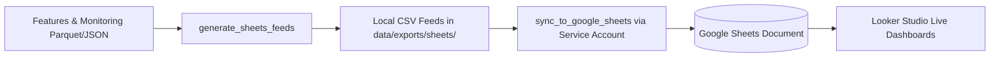

# Google Sheets & Looker Studio Integration Guide

This document describes the automated sync pipeline connecting the Ticket Triage Agent's operational and model monitoring feeds to **Google Sheets** and **Google Looker Studio**, as implemented in [sheets_bridge.py](../src/triage/monitoring/sheets_bridge.py).


---

## 1. Architecture Overview

The monitoring pipeline uses a direct **Google Sheets API v4** service account integration. Rather than relying on fragile webhooks or public CSV URLs, the backend pushes data directly into a private Google Spreadsheet:



### Generated Feeds and Sheet Tabs

The bridge generates 4 structured feeds locally in `data/exports/sheets/` and syncs them to corresponding worksheet tabs:

| Sheet Tab / Feed File | Source & Granularity | Columns / Schema |
| :--- | :--- | :--- |
| **`daily_triage_kpi`** | `data/interim/features.parquet` (daily aggregation) | `Date`, `Total_Tickets`, `Closed_Tickets`, `Not_Planned_Tickets`, `Incomplete_Tickets`, `Completeness_Rate_Pct`, `Not_Planned_Rate_Pct`, `Avg_Body_Length_Words` |
| **`integration_health`** | `data/interim/features.parquet` (per-integration, $N \ge 5$) | `Integration`, `Total_Issues`, `Incomplete_Rate_Pct`, `Not_Planned_Rate_Pct`, `Has_Traceback_Pct`, `Median_Days_To_Close` |
| **`model_performance`** | `data/monitoring/performance_history.json` (rolling cohorts) | `Window_Start`, `Window_End`, `Split`, `Sample_Type`, `Resolved_Tickets`, `Survival_C_Index`, `Not_Planned_PR_AUC`, `Not_Planned_Brier`, `Label_Accuracy` |
| **`drift_monitoring`** | `data/monitoring/drift_metrics.json` (hourly/daily drift) | `Evaluated_At`, `Feature_Or_Metric`, `Ref_Mean`, `Current_Mean`, `PSI_Score`, `KS_Statistic`, `Alert_Status` |

---

## 2. Configuration & Authentication

### 2.1 Service Account Setup
1. Create a Google Cloud Project with the **Google Sheets API** enabled.
2. Create a Service Account with private key access and download the credentials JSON file (e.g. `credentials/service_account.json`).
3. Create a target Google Spreadsheet (or use an existing one) and copy its Spreadsheet ID from the URL:
   `https://docs.google.com/spreadsheets/d/<GOOGLE_SHEET_ID>/edit`
4. Share the spreadsheet with the service account email (with **Editor** permissions).

### 2.2 Environment Variables
Configure `.env` with the service account path and sheet ID:

```bash
GOOGLE_SERVICE_ACCOUNT_JSON=credentials/service_account.json
GOOGLE_SHEET_ID=1abcXYZYourGoogleSpreadsheetIDHere
```

---

## 3. Executing Synchronization

### Direct Execution
Generate the local CSV exports and push them directly to Google Sheets:

```bash
python -m triage.monitoring.sheets_bridge
```

The bridge performs the following operations:
1. Validates local prerequisite files (`features.parquet`, `performance_history.json`, `drift_metrics.json`).
2. Computes aggregations and writes CSV feeds into `data/exports/sheets/`.
3. Authenticates via `google.oauth2.service_account.Credentials` using scope `https://www.googleapis.com/auth/spreadsheets`.
4. Inspects existing tabs via Google Sheets API v4 metadata; creates any missing tabs automatically via `batchUpdate`.
5. Clears previous values (`A:Z`) in each tab and batch-uploads fresh rows using `USER_ENTERED` parsing.
6. Reads back row counts to verify end-to-end data transmission integrity.

### Automated Orchestration
The Apache Airflow hourly DAG (`airflow/dags/triage_hourly.py`) invokes `export_bi` as Step 7 after model scoring and drift checks, ensuring the spreadsheet remains synchronized with lakehouse updates.

---

## 4. Connecting to Looker Studio

1. Open **[Looker Studio](https://lookerstudio.google.com/)** and select **Create > Data Source**.
2. Choose the **Google Sheets** connector.
3. Select your triage spreadsheet and link the four worksheets:
   - `daily_triage_kpi`
   - `integration_health`
   - `model_performance`
   - `drift_monitoring`
4. Recommended Looker Studio chart configurations:
   - **Executive Scorecards**: Completeness Rate (`Completeness_Rate_Pct`), Not-Planned Rate (`Not_Planned_Rate_Pct`), Total Volume (`Total_Tickets`).
   - **Daily Triage Timeline**: Combo chart with `Date` on the X-axis, `Total_Tickets` as bars, and `Completeness_Rate_Pct` as a trendline.
   - **Integration Risk Scatter**: Bubble chart of `Total_Issues` (X-axis) vs. `Median_Days_To_Close` (Y-axis), sized by `Incomplete_Rate_Pct` and colored by `Not_Planned_Rate_Pct`.
   - **Drift & PSI Alert Board**: Table visual filtered by `Alert_Status = 'ALERT'` or `'WARNING'` displaying features with significant distribution shift.
