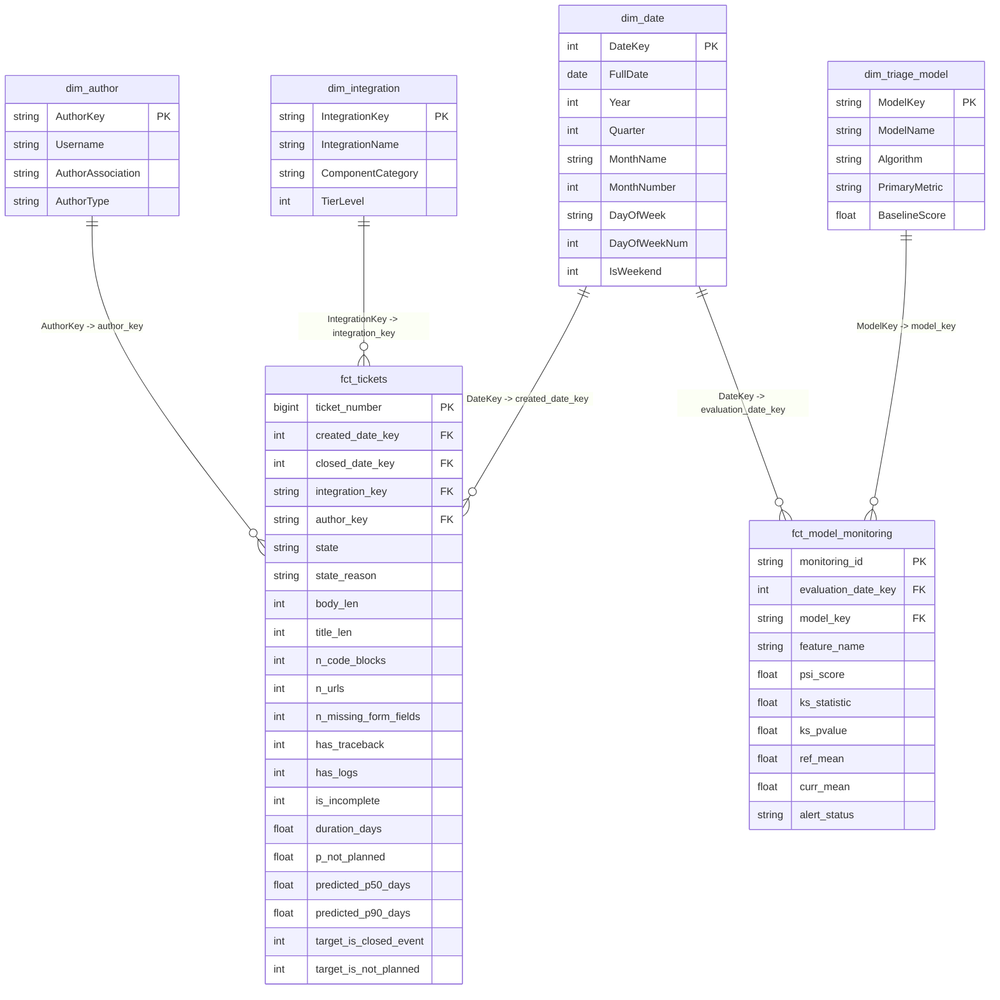

# Power BI Star Schema Architecture Specification (Phase 9)

This specification defines the dimensional data model designed for **Power BI Desktop**, **Power BI Service**, and offline BI reporting.

---

## 1. Dimensional Architecture Diagram

---

## 2. Table Specifications

### Fact Table: `fct_tickets`
- **Grain**: 1 row per unique GitHub issue.
- **Primary Key**: `ticket_number`
- **Foreign Keys**:
  - `created_date_key`: Formatted `YYYYMMDD` integer mapped to `dim_date[DateKey]`.
  - `integration_key`: Standardized integration token mapped to `dim_integration[IntegrationKey]`.
  - `author_key`: GitHub author login mapped to `dim_author[AuthorKey]`.
- **Degenerate Dimensions**: `state`, `state_reason`, `title`.
- **Numeric Measures**:
  - `duration_days`: Resolution elapsed days (actual).
  - `predicted_p50_days`: 50th percentile resolution forecast.
  - `predicted_p90_days`: 90th percentile resolution forecast.
  - `p_not_planned`: Machine learning probability (0.0 to 1.0) of closing without fix.
  - `body_len`, `n_code_blocks`, `n_urls`, `n_missing_form_fields`.
- **Binary Indicator Flags**:
  - `is_incomplete`: `1` if flagged by completeness engine, `0` otherwise.
  - `has_traceback`: `1` if Python traceback detected, `0` otherwise.
  - `has_logs`: `1` if system log snippet detected, `0` otherwise.
  - `target_is_not_planned`: `1` if final state reason is not-planned / won't fix.

### Dimension Table: `dim_date`
- **Grain**: 1 row per calendar day.
- **Attributes**: `DateKey`, `FullDate`, `Year`, `Quarter`, `MonthName`, `MonthNumber`, `DayOfWeek`, `IsWeekend`.
- **Hierarchies**: `Year > Quarter > MonthName > FullDate`.

### Dimension Table: `dim_integration`
- **Grain**: 1 row per Home Assistant Core integration component.
- **Attributes**:
  - `IntegrationKey`: Lowercase token (e.g., `mqtt`, `tasmota`, `zha`, `homekit`).
  - `IntegrationName`: Display name.
  - `ComponentCategory`: Domain taxonomy (`Home Automation`, `Lighting`, `Climate`, `Media`, `Core`).
  - `TierLevel`: Tier 1 (top 20 volume), Tier 2 (active), Tier 3 (long tail).

### Dimension Table: `dim_author`
- **Grain**: 1 row per unique GitHub contributor.
- **Attributes**: `AuthorKey`, `Username`, `AuthorAssociation` (`OWNER`, `MEMBER`, `CONTRIBUTOR`, `FIRST_TIME_CONTRIBUTOR`, `NONE`).

### Fact Table: `fct_model_performance`
- **Grain**: 1 row per out-of-sample evaluation window/cohort.
- **Attributes**: `window_start`, `window_end`, `days`, `sample_type`, `n_tickets`, `survival_c_index`, `survival_mae_days`, `not_planned_pr_auc`, `not_planned_brier`, `label_accuracy`, `label_macro_f1`, `evaluated_at`.

### Fact Table: `fct_retrain_decisions`
- **Grain**: 1 row per retrain evaluation demonstration path.
- **Attributes**: `path_name`, `description`, `training_dataset_size`, `metric_evaluated`, `champion_metric`, `candidate_metric`, `delta`, `margin_required`, `is_promoted`, `final_decision`, `evaluated_at`.

### Mart Table: `mart_weekly_volume`
- **Grain**: 1 row per ISO calendar week.
- **Attributes**: `week_start`, `opened_count`, `closed_count`, `rolling_4wk_avg`.

---

## 3. Power BI Data Source Configuration

### Live Databricks SQL Warehouse (Primary Source)
1. In Power BI Desktop: **Get Data > More... > Databricks**.
2. Server Hostname & HTTP Path from `.env`.
3. Authentication: **Personal Access Token (PAT)** (`DATABRICKS_TOKEN`).
4. Select Catalog: `workspace`, Schema: `gold`.
5. Load:
   - `workspace.gold.fct_tickets`
   - `workspace.gold.fct_model_monitoring`
   - `workspace.gold.fct_model_performance`
   - `workspace.gold.fct_retrain_decisions`
   - `workspace.gold.mart_weekly_volume`

*(Offline Fallback: Load CSV tables from `data/exports/powerbi/`).*

### Stated Business Assumptions
- **Resolution SLA**: 14 calendar days from creation to closure.
- **High-Risk Threshold**: Predicted not-planned probability $\ge 0.35$.

